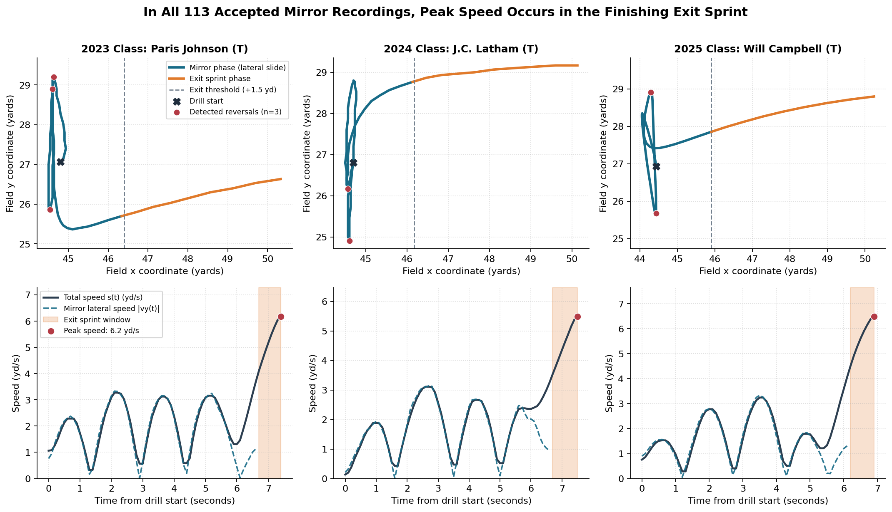
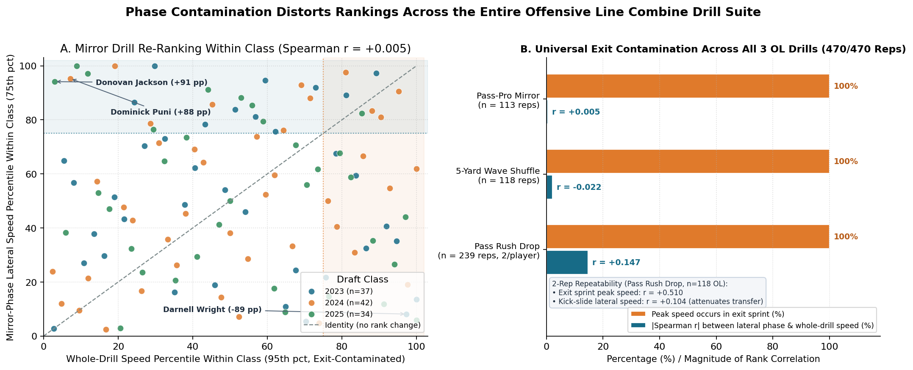
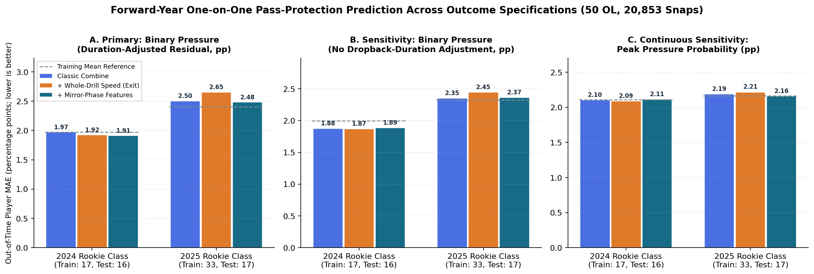
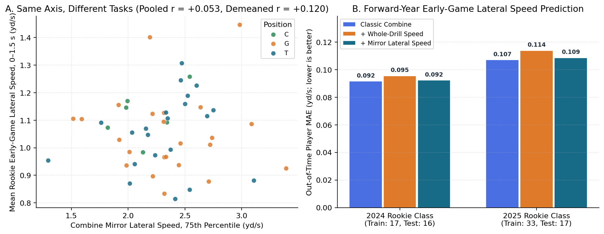

# 🎓 İnanılmaz Bir Sunum İçin Master Çalışma Kağıdı ve Yol Haritası

Bu belge, projedeki **tüm dosyaları, grafikleri, formülleri, sayıları ve hikayeyi** sıfırdan başlayıp **1 saat içinde tamamen kendi projenmiş gibi su gibi anlatabilecek seviyeye gelmen** için hazırlanmış adım adım çalışma kılavuzudur.

> **Tarayıcıda Renkli / Etkileşimli Çalışmak İstersen:** Aynı rehberin görsel kartlı ve işaretlenebilir (checkbox'lı) web versiyonunu **[`MASTER_CALISMA_KAGIDI_VE_YOL_HARITASI.html`](file:///d:/NFL/MASTER_CALISMA_KAGIDI_VE_YOL_HARITASI.html)** dosyasına çift tıklayarak açabilirsin!

---

## ⏱️ BÖLÜM 1: 60 Dakikalık Çalışma Programı (Neyi, Hangi Sırayla Açıp Bakmalısın?)

Kafanın karışmaması için dosyaları rastgele açma; **tam olarak şu 4 adımlık sırayla** ilerle:

### Adım 1 (Dakika 00–10): Önce Gözünle Gör ve Hikayeyi Hisset
1. **[`ANIMASYON_SIMULATORU.html`](file:///d:/NFL/ANIMASYON_SIMULATORU.html)** dosyasına çift tıkla ve tarayıcıda aç.
2. **1. Sekmede ("Canlı Oyuncu Yarışı"):** Ekranda solda **Donovan Jackson**, sağda **Tyler Booker** otomatik olarak yarışmaya başlayacak.
   - Şuna dikkat et: İlk 6–7 saniyede (Mavi Faz) Donovan Jackson sağa-sola çok hızlı kayıyor, Tyler Booker ise yavaş kalıyor. Ama beyaz kesikli **`+1.5 yd Çıkış Sınırı`** çizgisini geçtikleri anda (Turuncu Faz — Çıkış Sprinti) Tyler Booker bir anda roket gibi depar atıyor!
   - **İşte projenin ana fikri bu:** Eğer bilgisayara *"Bu dosyadaki en yüksek hızı al"* dersen, bilgisayar mavi yanal kaymayı değil, turuncu düz koşuyu alıyor!
3. **2. Sekmeye ("NFL Maç İçi 1-on-1 Pas Koruması Simülasyonu")** tıkla ve 1 dakika izle: Orada `QB`, `C`, `G`, `T` ve `DL`'nin sahada nasıl çarpıştığını ve sağ üstteki `NGS Baskı Olasılığı` barının nasıl çalıştığını gör.

### Adım 2 (Dakika 10–25): Terimleri Cebine Koy
1. **[`TERIMLER_VE_KAVRAMLAR_REHBERI.html`](file:///d:/NFL/TERIMLER_VE_KAVRAMLAR_REHBERI.html)** (veya editörde [`TERIMLER_VE_KAVRAMLAR_REHBERI.md`](file:///d:/NFL/TERIMLER_VE_KAVRAMLAR_REHBERI.md)) dosyasını aç.
2. Yukarıdan aşağıya 4 bölümü oku:
   - **Bölüm 1:** Sahada kim nerede duruyor (`QB`, `OL: C/G/T`, `DL`, `WR`, `Snap`, `Dropback`, `1-on-1`, `Pressure`).
   - **Bölüm 2:** Combine'daki 3 OL drili (`Pass-Pro Mirror`, `5-Yard Wave`, `Pass Rush Drop`).
   - **Bölüm 3:** Sinyal işleme (`Savitzky–Golay (5,2)`, `lateral_speed_p75`, `reversal_recovery`, `whole_drill_speed`).
   - **Bölüm 4:** İstatistik ve modeller (`Spearman r`, `Repeatability`, `Psychometric Attenuation`, `Out-of-Time`, `Ridge`, `MAE`, `Bootstrap`).

### Adım 3 (Dakika 25–45): Slaytları ve Konuşma Metnini Yan Yana Koyup Sesli Prova Yap
1. Ekranın sol yarısında **[`SUNUM_HOCALARA.html`](file:///d:/NFL/SUNUM_HOCALARA.html)** slayt sunumunu aç.
2. Ekranın sağ yarısında (veya telefonunda) **[`SUNUM_REHBERI_VE_KONUSMA_METNI.md`](file:///d:/NFL/SUNUM_REHBERI_VE_KONUSMA_METNI.md)** dosyasını aç (zaten `SUNUM_HOCALARA.html` içinde sağda da konuşmacı notları var!).
3. **Slayt 1'den Slayt 12'ye kadar** her slaytta konuşma metnini **sesli olarak** oku ve slayttaki tabloya/grafiğe bak.

### Adım 4 (Dakika 45–60): Grafik Okuma ve Soru-Cevap Provası
1. Bu çalışma kağıdının **Bölüm 4 (Grafik Okuma Rehberi)** ve **Bölüm 5 (Altın Sayılar Ezber Kartı)** kısımlarını oku.
2. **[`submission_mirror/mirror_explorer.html`](file:///d:/NFL/submission_mirror/mirror_explorer.html)** dosyasını aç, sağ üstteki **`EN / TR`** butonuna basmayı ve listeden oyuncu değiştirmeyi dene (sunumda hocalara 15 saniye canlı göstermek çok puan kazandırır!).

---

## 🗺️ BÖLÜM 2: Projedeki Tüm Dosyaların Haritası ("Hangi Dosya Ne İşe Yarıyor?")

Proje klasöründe (`d:\NFL`) gördüğün dosyaların görev dağılımı şöyledir:

| Dosya Adı | Kimin İçin? | Ne İşe Yarıyor? |
| :--- | :--- | :--- |
| **[`SUNUM_HOCALARA.html`](file:///d:/NFL/SUNUM_HOCALARA.html)** | **Sen & Hocalar** | Projeksiyonda açacağın **12 slaytlık ana akademik sunum** (`←`/`→` ok tuşları, `F` tam ekran, `N` konuşmacı notları). |
| **[`SUNUM_REHBERI_VE_KONUSMA_METNI.md`](file:///d:/NFL/SUNUM_REHBERI_VE_KONUSMA_METNI.md)** | **Sen** | 12 slaytın her birinde hocalara kelimesi kelimesine söyleyeceğin metin ve hoca sorularının cevapları. |
| **[`ANIMASYON_SIMULATORU.html`](file:///d:/NFL/ANIMASYON_SIMULATORU.html)** | **Sen, Arkadaşların & Hocalar** | 113 gerçek oyuncuyu canlı yarıştıran ve NFL maç simülasyonu yapan **60 FPS etkileşimli animasyon stüdyosu**. |
| **[`MIRROR_FAZ_ANIMASYONU.gif`](file:///d:/NFL/MIRROR_FAZ_ANIMASYONU.gif)** | **Sunum / WhatsApp** | Donovan Jackson vs. Darnell Wright karşılaştırmasını gösteren hazır hareketli `.gif` animasyonu. |
| **[`TERIMLER_VE_KAVRAMLAR_REHBERI.html`](file:///d:/NFL/TERIMLER_VE_KAVRAMLAR_REHBERI.html)** | **Sen** | Saha şemaları, dril çizimleri ve günlük hayat örnekleriyle tüm terimlerin görsel sözlüğü (`.md` versiyonu da var). |
| **[`submission_mirror/mirror_explorer.html`](file:///d:/NFL/submission_mirror/mirror_explorer.html)** | **Yarışma Jürisi & Hocalar** | 113 OL oyuncusunu yıl, pozisyon ve sıralama farkına göre filtreleyen iki dilli (`TR/EN`) karar destek aracı. |
| **[`submission_mirror/writeup_en.md`](file:///d:/NFL/submission_mirror/writeup_en.md)** | **Kaggle Yarışma Jürisi** | Yarışmaya teslim edilen `1.929` kelimelik resmi İngilizce bilimsel makale. |
| **[`submission_mirror/mirror_phase_validation.executed.ipynb`](file:///d:/NFL/submission_mirror/mirror_phase_validation.executed.ipynb)** | **Kaggle Jürisi & Teknik Denetim** | Ham CSV verilerinden tüm analizleri, grafikleri ve 400 bootstrap testini `0` hatayla üreten çalıştırılmış Jupyter Notebook. |
| **[`reports/experiment_register.md`](file:///d:/NFL/reports/experiment_register.md)** | **Akademik Şeffaflık** | Projede denenen tüm olumlu ve olumsuz 10 deneyin kronolojik kayıt defteri (p-hacking yapılmadığının kanıtı). |
| **[`CALISMA_DURUMU.md`](file:///d:/NFL/CALISMA_DURUMU.md) & [`SONUC.md`](file:///d:/NFL/SONUC.md)** | **Sen** | Projenin genel Türkçe yönetici özeti ve değerlendirme raporu. |

---

## 🔗 BÖLÜM 3: Projenin "Tek Bakışta" Mantık Zinciri (Hikayenin İskeleti)

Sunum yaparken aklında tutacağın hikaye **5 halkalı bir zincirdir**:

```text
[1. SORU] Combine'da hücum hattı (OL) oyuncularının yanal çevikliğini ölçmek için yapılan drillerde "hız" metriği neyi ölçüyor?
    │
    ▼
[2. KEŞİF] 3 OL drilindeki (Mirror, Wave, Drop) 470 kaydın 470'inde (%100) zirve hız yanal harekette değil, dril sonundaki DÜZ ÇIKIŞ SPRİNTİNDE oluşuyor!
    │
    ▼
[3. SONUÇ 1: SIRALAMA KIRILMASI] Çıkış sprintini ayırmazsak oyuncu sıralamaları tamamen bozuluyor (Yanal hız vs. Tüm-kayıt hızı korelasyonu r = +0.005; 2025 üst çeyrekteki 9 oyuncudan yalnız 1'i ortak!).
    │
    ▼
[4. SONUÇ 2: NEDEN TEK TEKRARLI DRİL SINIRLI?] İkişer kez koşulan Pass Rush Drop drilinde (118 OL) düz çıkış sprinti r = +0.510 ile tekrarlanırken, koç işaretine bağlı yanal hız yalnız r = +0.104 ile tekrarlanıyor (Psikometrik Zayıflama Sınırı).
    │
    ▼
[5. SONUÇ 3: GERÇEK NFL MAÇ TESTİ (20.853 SNAP)] Kirli tüm-kayıt hızı 2025 maç tahminlerini KÖTÜLEŞTİRİRKEN, bizim izole ettiğimiz Mirror fazı özellikleri hatayı DÜŞÜRÜYOR; ancak güven aralığı [−0.264, +0.353] sıfırı kestiği için dürüst bir 4-aşamalı doğrulama hunisi sunuyoruz.
```

---

## 📊 BÖLÜM 4: Grafik Okuma Rehberi ("Slaytta Bu Grafik Çıktığında Parmağınla Nereyi Göstereceksin?")

Sunumda 4 ana grafiğimiz var. Her biri ekrana geldiğinde **tam olarak nereyi işaret edeceğin** aşağıdadır:

### Grafik 1: [`mirror_phase_story.png`](file:///d:/NFL/reports/trenches/mirror_phase_story.png) (Slayt 4'teki Grafik)

- **Üst Satır (3 Kutu):** 2023 (`Paris Johnson`), 2024 (`J.C. Latham`) ve 2025 (`Will Campbell`) sınıflarından 3 oyuncunun sahadaki kuşbakışı koşu izi (`x` ve `y` yard cinsinden).
  - **Parmağınla Göster:** *"Bakın hocam, sol taraftaki **mavi zikzaklar** oyuncunun sağa-sola kaydığı gerçek Mirror (ayna) fazı. Üzerindeki **kırmızı noktalar** algoritmamızın yakaladığı yön değişimleri. Dikey kesikli çizgi (`+1.5 yd`) geçildiği anda başlayan **turuncu çizgi** ise çıkış sprinti."*
- **Alt Satır (3 Kutu):** Aynı oyuncuların zamana göre hız (`yd/s`) grafiği.
  - **Parmağınla Göster:** *"Mavi kesikli çizgi yanal hızı (`|vy(t)|`), koyu düz çizgi toplam hızı (`s(t)`) gösteriyor. İlk 6 saniyede hız `2–3 yd/s` civarında dalgalanırken, sağdaki **turuncu gölgeli çıkış sprinti bölgesinde** hız `6.2 – 6.5 yd/s` zirvesine (kırmızı nokta) fırlıyor! 113 oyuncunun 113'ünde de kırmızı zirve nokta bu turuncu bölgede!"*

---

### Grafik 2: [`mirror_ranking_shift.png`](file:///d:/NFL/reports/trenches/mirror_ranking_shift.png) (Slayt 5'teki Grafik)

- **Sol Panel (Panel A — Dağılım Grafiği):**
  - **X Ekseni (Yatay):** Çıkış sprintiyle kirlenmiş tüm-kayıt hızı yüzdelik sırası (`0`'dan `100`'e).
  - **Y Ekseni (Dikey):** Bizim temizlediğimiz Mirror yanal hız yüzdelik sırası (`0`'dan `100`'e).
  - **Parmağınla Göster:** *"Eğer iki ölçüm aynı şeyi ölçseydi, tüm noktalar ortadaki kesikli köşegen çizgi üzerinde dizilirdi. Oysa noktalar tüm ekrana rastgele dağılmış (`Spearman r = +0.005`)! Sol üst köşedeki **Donovan Jackson** ve **Dominick Puni** yanal çeviklikte sınıfın en iyisiyken (`94.` ve `95.` yüzdelik), çıkış sprintini yavaş koştukları için tüm-kayıt hızında en dipte (`3.` ve `7.` yüzdelik) görünüyorlar. Sağ alttaki **Darnell Wright** ise tam tersi!"*
- **Sağ Panel (Panel B — Yatay Çubuk Grafiği):**
  - **Parmağınla Göster:** *"Burada 3 OL drilinin tamamını (`Pass-Pro Mirror`, `5-Yard Wave`, `Pass Rush Drop` — toplam 470 kayıt) görüyorsunuz. **Turuncu çubuklar %100, %100, %100:** Yani üç drilde de zirve hız her zaman çıkış sprintinde! Mavi küçük çubuklar ise yanal hız ile tüm-kayıt hızı arasındaki korelasyonun üç drilde de sıfıra yakın olduğunu gösteriyor."*

---

### Grafik 3: [`mirror_model_comparison.png`](file:///d:/NFL/reports/trenches/mirror_model_comparison.png) (Slayt 8'deki Grafik)

- **Üç Panel Yan Yana:**
  - **Panel A:** Birincil hedef (Süre düzeltmeli ikili baskı).
  - **Panel B:** Duyarlılık 1 (Süre düzeltmesiz ikili baskı).
  - **Panel C:** Duyarlılık 2 (Sürekli NGS zirve baskı olasılığı `peak_pressure_probability_allowed`).
- **Sütun Renkleri:** Açık Mavi = `Klasik Combine`, Turuncu = `+ Tüm-Kayıt Hızı (Kirli)`, Koyu Mavi-Yeşil = `+ Mirror Fazı Özellikleri (Bizim Temizlediğimiz)`. **(Unutma: Sütun ne kadar KISA ise hata o kadar DÜŞÜK, yani model o kadar İYİ demektir!)**
- **Parmağınla Göster:** *"Her üç panelde de sağdaki **2025 Rookie Class** grubuna bakın: **Turuncu sütun** (kirli tüm-kayıt hızı) açık mavi klasik sütundan hep daha yüksek, yani modele çıkış sprintini eklemek tahmini bozmuş (`2.50 -> 2.65`, `2.35 -> 2.45`, `2.19 -> 2.21`). Bizim **koyu mavi-yeşil sütunumuz** ise Panel A ve Panel C'de hatayı düşürüyor (`2.50 -> 2.48` ve `2.19 -> 2.16`)."*

---

### Grafik 4: [`movement_bridge_results.png`](file:///d:/NFL/reports/trenches/movement_bridge_results.png) (Slayt 9'daki Grafik)

- **Sol Panel (Panel A):** Combine Mirror yanal hızı (yatay) ile NFL maçının ilk `1.5 saniyesindeki` ortalama yanal hız (dikey) arasındaki ilişki (`r = +0.053` ham, `r = +0.120` yıl/pozisyon arındırılmış).
- **Sağ Panel (Panel B):** 2024 ve 2025'te erken maç yanal hızını tahmin etme hatası (`MAE yd/s`).
- **Parmağınla Göster:** *"Combine'da boş sahada koçu takip ederken yapılan maksimum yanal hız, maçın ilk 1.5 saniyesindeki yanal hıza doğrudan taşınmıyor; çünkü maçta oyuncu maksimum hızla rastgele yana koşmaz, rakibinin hamlesine göre kontrollü adım atar."*

---

## 🏆 BÖLÜM 5: "Altın Sayılar" Ezber Kartı (Sunumda Söylediğinde Hocaları Etkileyecek 10 Sayı)

Bu 10 sayıyı aklında tutarsan sunumda hiçbir kağıda bakmadan bile tam hakimiyet kurarsın:

1. **`470 / 470 (%100.0)`:** 3 OL Combine drilinde (`113` Mirror + `118` Wave + `239` Drop) en yüksek hızın çıkış sprintinde oluşma oranı.
2. **`+1.5 yard` ve `0.4 saniye` (4 kare):** Mirror drilinde çıkış sprinti başlangıcını yakaladığımız geometrik eşik (`1.0` ve `2.0 yard` sınırlarında sıralama korelasyonu `r = 0.992` ve `0.998`).
3. **`Savitzky–Golay (5, 2)`:** `10 Hz` sensör verisinde hız tepeciklerini ezmeden türev almak için kullandığımız 5-kare 2. dereceden polinom filtresi.
4. **`Spearman r = +0.005`:** Mirror yanal hız sıralaması ile tüm-kayıt hızı sıralaması arasındaki korelasyon (tamamen ilişkisiz!).
5. **`9'da 1`:** 2025 draft sınıfında iki ölçümün üst çeyreğine (`%25`) giren 9 oyuncudan her iki listede ortak olan oyuncu sayısı.
6. **`r = +0.510` vs. `r = +0.104`:** `Pass Rush Drop` drilindeki `118` çift tekrarlı oyuncuda düz çıkış sprintinin tekrar güvenilirliği (`0.510`) ile koç işaretine bağlı yanal hızın tekrar güvenilirliği (`0.104`).
7. **`50 Çaylak OL` ve `20.853 Bire Bir Snap` (`1.850` Baskı):** NFL maç pas koruma veri setimizin büyüklüğü (`2023`: 17, `2024`: 16, `2025`: 17 oyuncu).
8. **`r = 0.367` → `r = 0.696`:** İkili (`0/1`) baskı yerine sürekli NGS `peak_pressure_probability_allowed` kullanıldığında maçtan maça hedef güvenilirliğinin iki katına çıkışı.
9. **`2.502 → 2.652 yp` (Kötüleşti) vs. `2.482 yp` (İyileşti):** 2025 birincil pas koruma testinde kirli tüm-kayıt hızının hatayı artırması, izole mirror özelliklerinin ise azaltması (sürekli olasılıkta `2.189 → 2.157 yp`).
10. **`[−0.264, +0.353]` yüzde puan:** `400` tam yeniden eğitimli (`full-refit bootstrap`) %95 güven aralığı.

---

## ✅ BÖLÜM 6: Sunum Öncesi Kendi Kendini Test Et (10 Soruluk Hızlı Kontrol)

Aşağıdaki 10 soruya kendi cümlelerinle cevap verebiliyorsan sunuma %100 hazırsın demektir:

1. **Soru:** Projenin tek cümlelik ana keşfi nedir?
   - *Cevap:* Hücum hattı (OL) Combine ayak işi drillerindeki 470 kaydın %100'ünde en yüksek hız yanal koruma fazında değil, dril sonundaki düz çıkış sprintinde oluşmaktadır; bu yüzden faz ayrımı yapmadan alınan hız metrikleri oyuncu sıralamalarını tamamen bozar (`r = 0.005`).
2. **Soru:** Hangi 3 OL Combine drilini inceledik ve kaç kayıt vardı?
   - *Cevap:* `Pass-Pro Mirror Drill` (113), `5-Yard Wave Drill` (118) ve `Pass Rush Drop` (239) — toplam 470 kayıt.
3. **Soru:** Ayna fazından hangi 2 özelliği çıkardık?
   - *Cevap:* `lateral_speed_p75` (75. yüzdelik yanal hız, `yd/s`) ve `reversal_recovery` (yön değişiminden `0.3–0.6 s` sonraki hızın dönüş öncesi `-0.5 ile -0.2 s` hıza oranı).
4. **Soru:** Neden yalnız çaylak (rookie) sezonlarını aldık?
   - *Cevap:* 2023 sınıfının 3 yıllık, 2025 sınıfının ise 1 yıllık maç verisi olduğu için tecrübe/maruziyet yanlılığını (*exposure bias*) önlemek amacıyla.
5. **Soru:** Veri sızıntısını (*data leakage*) nasıl önledik?
   - *Cevap:* Modelleri `2023` ile eğitip `2024`'te, `2023–2024` ile eğitip `2025`'te test ettik (*out-of-time*). Eksik veri doldurma, ölçekleme ve 1. aşama oyun bağlam modelini sadece eğitim yıllarında fit ettik.
6. **Soru:** Neden tek tekrarlı Mirror/Drop yanal hızı maç performansını güçlü tahmin edemiyor?
   - *Cevap:* Çünkü dril koçun anlık el/vücut işaretine bağlıdır; 118 oyuncunun 2 tekrarlı `Pass Rush Drop` verisinde yanal hızın tekrar güvenilirliği `r = 0.104` çıkmıştır. Psikometrik zayıflama teoremine ($|r_{XY}| \le \sqrt{r_{XX}\cdot r_{YY}}$) göre düşük tekrar güvenilirliği maç korelasyonunu matematiksel olarak sınırlar.
7. **Soru:** İkili `pressure_allowed` yerine sürekli `peak_pressure_probability_allowed` kullanmak ne sağladı?
   - *Cevap:* Maç hedefinin yarı-yarıya (*split-half*) güvenilirliğini `r = 0.367`'den `r = 0.696`'ya yükseltti ve 2025'te yine kirli hızın modeli bozduğunu (`2.189 -> 2.215`), izole mirror özelliklerinin ise hatayı düşürdüğünü (`2.189 -> 2.157`) doğruladı.
8. **Soru:** Neden XGBoost veya Derin Öğrenme yerine `Ridge(alpha=10)` kullandık?
   - *Cevap:* Oyuncu düzeyinde örneklem `n = 50` (test yıllarında 16 ve 17 oyuncu) olduğu için karmaşık modeller gürültüyü ezberler (*overfitting*); sabit cezalı doğrusal model sızıntısız ve sağlamdır.
9. **Soru:** Wide Receiver (`submission/`) çalışmamızda ne bulduk ve OL çalışmasıyla nasıl bütünleşiyor?
   - *Cevap:* WR `40-yard` zirve hızı çok yüksek tekrar güvenilirliğine (`r = 0.893`) ve maç rota hızıyla anlamlı korelasyona (`r = 0.382`) sahiptir, ancak klasik `40-yard` kronometre süresiyle (`r = -0.852`) aynı bilgiyi tekrar eder. OL yanal hızı ise klasik testlerden bağımsız yeni bir boyut ölçer ama koç yönlendirmeli olduğu için tekrar güvenilirliği (`r = 0.104`) düşüktür.
10. **Soru:** NFL takımlarına sunduğumuz 3 somut öneri nedir?
    - *Cevap:* (1) Dril dosyalarında çıkış sprintini ayırmadan hız özeti almayın, (2) Drillerde koç işareti yerine standart ışık/ekran sinyali kullanıp en az 2 tekrar alın, (3) Yeni sensör metriklerini 4-Aşamalı Doğrulama Hunisinden geçirmeden draft puanına katmayın.

