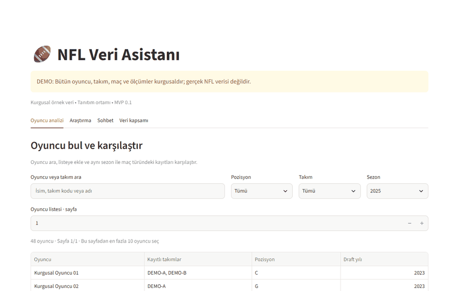
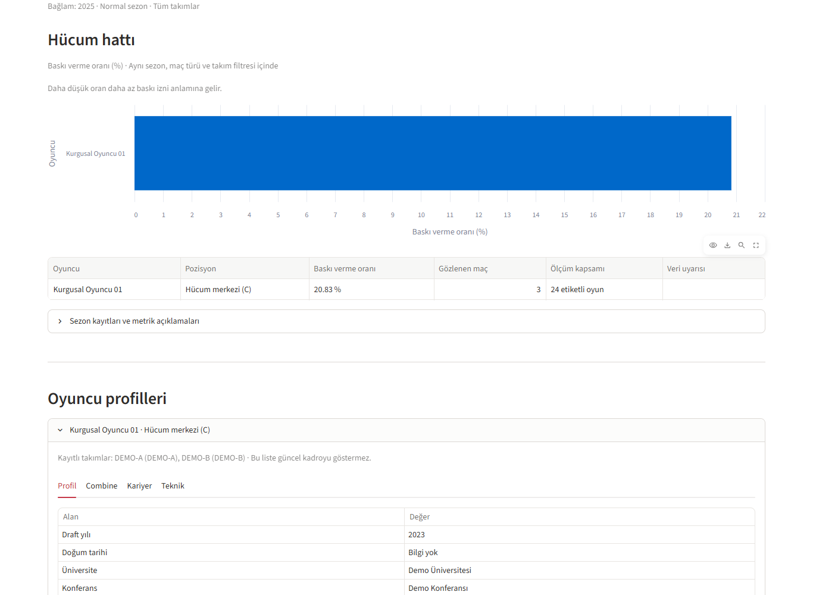
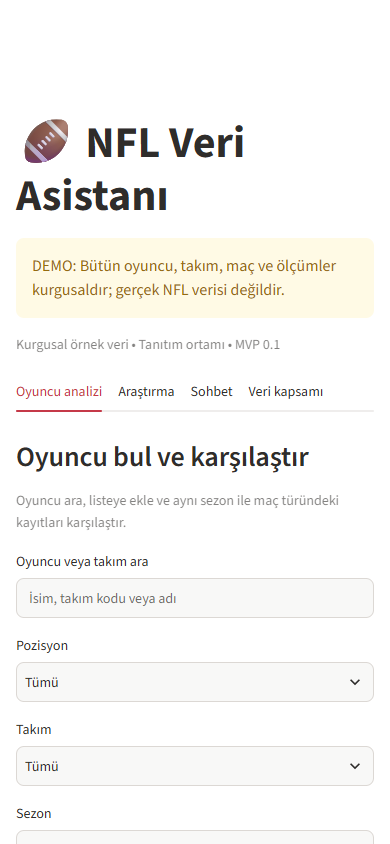

# NFL Big Data Bowl 2027 — Araştırma ve Veri Analiz Asistanı

[](https://github.com/aliberk1/NFL/actions/workflows/pull-request.yml)
[](https://github.com/aliberk1/NFL/actions/workflows/demo-health.yml)

**[Canlı demo](https://nfl-veri-asistani-demo.onrender.com/)** (kurgusal veri; uykudaysa açılması yaklaşık bir dakika sürer) ·
[v0.1.0 sürümü](https://github.com/aliberk1/NFL/releases/tag/v0.1.0) · [Mimari](docs/MIMARI.md) · [Sorun giderme](docs/SORUN_GIDERME.md) · [Sürüm notları](CHANGELOG.md) · [Sürüm süreci](docs/SURUM_SURECI.md)



| Karşılaştırma | Mobil |
| --- | --- |
|  |  |

Görüntülerdeki bütün oyuncular ve ölçümler kurgusaldır.

Bu proje, **NFL oyuncularının Combine testlerindeki hareketlerinin maç performansına ne kadar yansıdığını araştırır** ve aynı veri setini Türkçe sorgulamak için bir analiz uygulaması sunar.

Kısaca iki bölümden oluşur:

1. **Araştırma:** Oyuncu takip verilerinden hız ve hareket özellikleri çıkarır; bunların neyi ölçtüğünü ve gelecekteki sezon performansını açıklamaya katkısını test eder.
2. **Veri asistanı:** Yerel NFL verilerini oyuncu profilleri, karşılaştırma tabloları ve isteğe bağlı yapay zekâ sohbeti üzerinden incelemeyi sağlar.

## 1. Ana araştırma: En yüksek hız gerçekten neyi ölçüyor?

Ana çalışma, hücum hattı oyuncularının (**OL: C/G/T**) Combine ayak işi ve pas koruma drillerini inceler. Temel soru şudur:

> Bir oyuncunun drildeki en yüksek hızına bakınca pas korumadaki yanal hareketini mi, yoksa dril sonundaki düz çıkış sprintini mi ölçüyoruz?

Kodlar takip verisindeki hareketi fazlara ayırır; yanal hareket, yön değiştirme ve çıkış sprintini ayrı değerlendirir. Ardından bu ölçümleri çaylak sezonundaki pas koruma sonuçlarıyla karşılaştırır. Modeller geçmiş yıllarda eğitilip sonraki yılda sınanır.

**Depoda kayıtlı analiz sonuçları:**

- İncelenen üç OL drilindeki **470 kaydın tamamında** en yüksek hız çıkış sprintinde oluşmuştur. Bu sonuç incelenen örnekleme aittir.
- Mirror drilinde **113 oyuncu** için tüm drilin hızıyla yanal faz hızının oyuncu sıralamaları neredeyse ilişkisizdir (`Spearman r = 0.005`).
- Maç performansı modellemesi **50 çaylak OL ve 20.853 bire bir pas koruma oyununu** kapsar.
- Faz ayrıştırılmış özellikler 2025 testinde klasik modele göre küçük bir hata azalması sağlamıştır (MAE 2,502 → 2,482 puan); ancak bootstrap güven aralıkları sıfırı içerir. Aynı testte basit ortalama referansı (MAE 2,405) ikisinden de düşük hata vermiştir. **Tutarlı ek tahmin faydası kanıtlanmış değildir.**

Çalışmanın temel katkısı, tek bir “hız” değerinin yanlış hareketi temsil edebileceğini göstermesi ve bunu incelemek için yeniden çalıştırılabilir bir analiz sunmasıdır.

**Başlangıç dosyaları:**

- [Ana araştırma yazısı (İngilizce)](submission_mirror/writeup_en.md)
- [Çalıştırılabilir notebook](submission_mirror/mirror_phase_validation.ipynb)
- [Çıktıları kaydedilmiş notebook](submission_mirror/mirror_phase_validation.executed.ipynb)
- [Etkileşimli oyuncu inceleyicisi](submission_mirror/mirror_explorer.html): dosyayı indirip tarayıcıda açın; oyuncu, yıl ve pozisyona göre saha izi ve hız eğrilerini inceleyin.
- [Teslim paketi ve yeniden üretim rehberi](submission_mirror/README_TR.md)

## 2. İkinci araştırma: WR hız transferi

Wide Receiver (**WR**, pas yakalayıcı) çalışması, Combine hız ölçümlerinin maç içindeki rota hızına aktarımını araştırır.

- Maç analizi **58 çaylak WR ve 10.944 rota oyununu** kapsar.
- Combine zirve hızıyla maç rota hızı arasında ilişki bulunmuştur.
- Ancak klasik 40-yard koşu süresine ek tahmin katkısı yıllar arasında tutarlı değildir: 2024'te iyileşme görülürken 2025'te görülmemiştir; iki yılda da güven aralığı sıfırı içerir.

[Araştırma yazısı](submission/writeup_en.md) · [Notebook](submission/receiver_speed_translation.ipynb) · [Çalıştırma rehberi](submission/README_TR.md)

## 3. Türkçe NFL veri asistanı

Streamlit arayüzünde:

- Oyuncuları adlarına göre arayabilir, profillerini ve Combine bilgilerini inceleyebilirsiniz.
- Aynı pozisyon ve draft sınıfından en fazla 10 oyuncunun kayıtlı sezon performansını karşılaştırabilirsiniz.
- Normal sezon, play-off ve sezon öncesi kayıtlarını ayrı görüntüleyebilirsiniz.
- Profildeki **Benzer profiller** sekmesinde aynı pozisyon grubundan Combine ölçümleri en yakın beş oyuncuyu, havuz büyüklüğü ve mesafe aralığıyla görebilirsiniz. Bu liste başarı tahmini değildir; [ileri-yıl deneyinde](docs/BENZER_OYUNCU.md) tutarlı tahmin faydası gösterilemedi.
- Veri setinde hangi takım ve sezonların ne ölçüde temsil edildiğini görebilirsiniz.
- **Araştırma** sekmesinde OL mirror fazlarını zaman/hız grafiğinde inceleyebilir; WR hız aktarım sonuçlarını, kohortları ve sınırlarını görebilirsiniz. Araştırma çıktıları manifestteki SHA-256 özetleriyle doğrulanır; bu sekme temel DuckDB veritabanı oluşturulmadan da açılır.
- Bir LLM sağlayıcısı bağlayarak veri seti hakkında Türkçe sorular sorabilir, cevabın dayandığı araç çıktılarını açabilir ve konuşmayı indirebilirsiniz.

**Veri akışı:** Yerel CSV dosyaları → DuckDB → analiz fonksiyonları → Streamlit arayüzü / FastAPI. Sohbet modeli, analiz araçlarının sonuçlarını kullanarak açıklama üretir.

Oyuncu analizi ve veri kapsamı ekranları LLM anahtarı olmadan çalışır. Sohbet için araç çağırabilen, OpenAI-uyumlu bir sağlayıcı gerekir.

### Mevcut sınırlar

- Uygulama bir MVP'dir; Araştırma sekmesi sürümlenmiş sonuçları ve mevcut OL inceleyicisini sunar, notebook modellerini uygulama içinde yeniden eğitmez.
- Uygulamanın veri yükleyicisi beş temel CSV'yi yükler; ayrıntılı tracking verisini yüklemez. Tracking analizi araştırma kodları ve notebook'larda yapılır.
- Takım kapsam tabloları tam kadroyu, takım gücünü veya maç kazanma olasılığını göstermez.
- Kariyer toplamları zaman damgasızdır; geçmişe dönük tahmin modellerinde doğrudan girdi olarak kullanılmamalıdır.
- Harici LLM kullanıldığında soru ve seçilen araç sonuçları sağlayıcıya gönderilir.

Sonraki adımlar: gerçek LLM bağlantısıyla uçtan uca sohbet doğrulaması ve yeni sezonla bağımsız doğrulama. Tam liste: [bilinen sınırlar](CHANGELOG.md).

## Docker ile hızlı demo

```sh
docker compose up --build -d --wait
```

http://127.0.0.1:8501 adresinde **tamamen kurgusal** veriyle açılır; yarışma verisi veya LLM
anahtarı gerekmez. Yayın, kullanım sınırları, yedekleme ve geri dönüş:
[Docker, demo ve yayın rehberi](docs/DEMO_VE_YAYIN.md).

## Kurulum ve çalıştırma

### 1. Projeyi ve bağımlılıkları hazırlayın

Aşağıdaki komutlar Windows PowerShell içindir:

```powershell
git clone https://github.com/aliberk1/NFL.git
cd NFL
python -m venv .venv
.\.venv\Scripts\python.exe -m pip install -r requirements-app.txt
```

### 2. Veri setini yerleştirin

NFL Big Data Bowl 2027 ham verisini ayrıca edinip şu klasöre açın:

```text
data/nfl-big-data-bowl-2027/
```

Uygulama için bu klasörde şu dosyalar bulunmalıdır:

```text
players.csv
games.csv
combine_results.csv
player_career_successes.csv
player_play.csv
```

Araştırma notebook'ları bunlara ek olarak yarışmanın ilgili Combine ve maç tracking CSV'lerini de gerektirir.

**Ham veri, `.venv`, `.env`, ZIP arşivleri ve oluşturulan DuckDB/Parquet dosyaları `.gitignore` gereği GitHub'a yüklenmez.** Depoyu klonlamak tek başına ham veriyi getirmez; hazır araştırma raporları ve notebook çıktıları ise depoda bulunur.

### 3. Veritabanını oluşturup arayüzü başlatın

```powershell
.\.venv\Scripts\python.exe -m pipelines.ingest
.\.venv\Scripts\python.exe -m streamlit run app/ui.py --server.address 127.0.0.1
```

Arayüz varsayılan olarak `http://127.0.0.1:8501` adresindedir. Veri yükleyici anahtar tekilliğini ve oyuncu/maç bağlantılarını kontrol eder; veritabanını `data/curated/nfl.duckdb` konumunda oluşturur.

Yükleme; şema, eksik değer ve anahtar eşleşmelerini denetler. Kaynak ve veri sürümü data/curated/catalog.json, ayrıntılı kalite raporu data/curated/quality_report.json dosyasına yazılır. Metriklerin kapsamı ve yorum sınırları için [veri kalitesi rehberine](docs/VERI_KALITESI.md) bakın.

### 4. İsteğe bağlı sohbet bağlantısı

Arayüzü başlatacağınız terminalde:

```powershell
$env:NFL_LLM_API_KEY = "anahtarınız"
$env:NFL_LLM_MODEL = "sağlayıcınızdaki-model-kimliği"
$env:NFL_LLM_BASE_URL = "https://api.openai.com/v1"
```

Ardından Streamlit komutunu çalıştırın. `.env.example` açıklama içindir; `.env` otomatik okunmaz.

[LLM ve Gemini kurulum rehberi](docs/LLM_KURULUMU.md) · [EVREN kurulumu](docs/EVREN_KURULUMU.md)

### 5. İsteğe bağlı API

```powershell
.\.venv\Scripts\python.exe -m uvicorn app.api:app --host 127.0.0.1 --port 8000
```

API belgeleri: `http://127.0.0.1:8000/docs`

## Araştırmayı yeniden çalıştırma

Ham veri hazırlandıktan sonra notebook bağımlılıklarını kurun:

```powershell
.\.venv\Scripts\python.exe -m pip install -r requirements-notebook.txt
```

Ana OL çalışmasının notebook'unu üretip doğrulamak için:

```powershell
.\.venv\Scripts\python.exe scripts/build_mirror_notebook.py
.\.venv\Scripts\python.exe scripts/verify_mirror_notebook.py
```

WR çalışması için:

```powershell
.\.venv\Scripts\python.exe scripts/build_submission_notebook.py
.\.venv\Scripts\python.exe scripts/verify_submission.py
```

Doğrulama betikleri notebook'ları yeniden çalıştırır ve üretilen sonuçları referans tablolarla karşılaştırır. Doğrulama özetleri `verification/` içindeki JSON dosyalarında ve teslim klasörlerindeki `verification.json` dosyalarındadır. Yeniden üretilen `verification/notebook_run/` ve `verification/mirror_notebook_run/` çalışma klasörleri yerelde tutulur, GitHub'a yüklenmez. Paketleme betiklerinden önce ilgili doğrulama betiğini çalıştırın.

Notebook'lar Kaggle'a içe aktarılarak yarışma verisi bağlandıktan sonra da çalıştırılabilir. Yerel çalıştırma ve teslim ayrıntıları ilgili teslim klasörlerinin rehberlerinde bulunur.

Uygulama testleri:

```powershell
.\.venv\Scripts\python.exe -m pytest -q
```

## Depo düzeni

| Yol | İçerik |
| --- | --- |
| `app/` | Analiz fonksiyonları, LLM asistanı, Streamlit arayüzü ve FastAPI |
| `pipelines/` | CSV → DuckDB yükleme ve LLM bağlantı kontrolü |
| `scripts/` | Veri denetimi, özellik çıkarımı, modelleme, görselleştirme ve paketleme |
| `reports/` | Araştırma tabloları, grafikler ve deney kayıtları |
| `submission_mirror/` | Ana OL faz ayrıştırma çalışması ve teslim dosyaları |
| `submission/` | WR hız transferi çalışması ve teslim dosyaları |
| `verification/` | Doğrulama özetleri; yeniden çalıştırma klasörleri Git dışında tutulur |
| `tests/` | Uygulama testleri |
| `docs/` | Sağlayıcı kurulumu, koç soruları ve yanıt kalitesi belgeleri |

## Sunumlar ve ek açıklamalar

Ekip görev alma, bağımlılık kilidi ve PR süreci: [Ekip çalışma düzeni](docs/EKIP_CALISMA_DUZENI.md).

- [Güncel araştırma durumu](CALISMA_DURUMU.md)
- [Deney kayıt defteri](reports/experiment_register.md)
- [Görsel terimler ve kavramlar rehberi](TERIMLER_VE_KAVRAMLAR_REHBERI.html)
- [Sunum](SUNUM_HOCALARA.html) ve [konuşma rehberi](SUNUM_REHBERI_VE_KONUSMA_METNI.md)
- [Animasyon simülatörü](ANIMASYON_SIMULATORU.html)
- [Koç soruları ve geliştirme hedefleri](docs/KOC_SORULARI.md)

HTML sunum ve inceleyicilerini kullanmak için dosyaları yerel olarak tarayıcıda açın.

## Lisans ve veri koşulları

- **Kod:** Lisans henüz depo sahibi tarafından belirlenmedi; bir lisans dosyası eklenene kadar kullanım izni verilmiş sayılmaz.
- **Yarışma verisi:** Ayrı koşullara tabidir (CC BY-NC 4.0 ve [yarışma kuralları](https://www.kaggle.com/competitions/nfl-big-data-bowl-2027/rules)); ham CSV'ler depoda yoktur. Kod lisansı veriyi kapsamaz.
- **Kurgusal demo verisi:** Depodaki kodla üretilir, yarışma verisi içermez.
- Ayrıntılar ve açık konular: [Veri ve görsel paylaşım koşulları](docs/DEMO_VE_YAYIN.md#veri-ve-görsel-paylaşım-koşulları).
