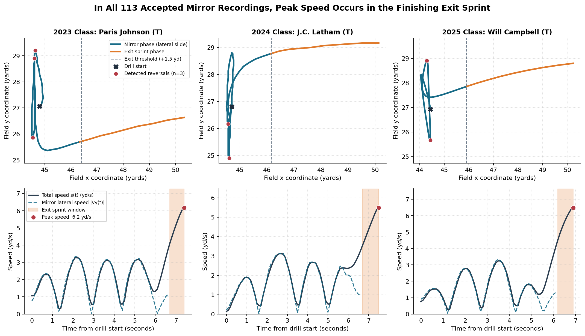
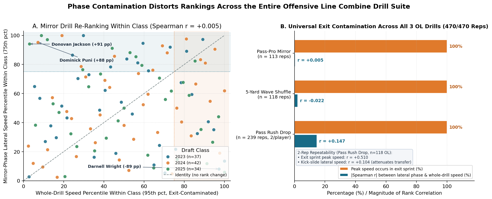
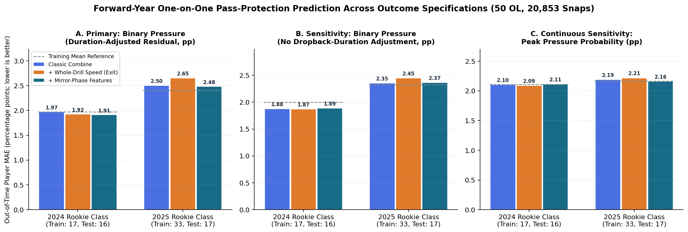

# 🏈 NFL Big Data Bowl 2027 — Görselli Terimler ve Kavramlar Sözlüğü

> **İpucu:** Bu rehberin **renkli saha çizimleri, etkileşimli arama çubuğu ve görsel diyagramlar** içeren web sürümünü tarayıcıda açmak için **[`TERIMLER_VE_KAVRAMLAR_REHBERI.html`](file:///d:/NFL/TERIMLER_VE_KAVRAMLAR_REHBERI.html)** dosyasına çift tıklayabilirsin!

---

## Bölüm 1: Amerikan Futbolu Pozisyonları ve Maç Terimleri

### Saha Dizilişi Şeması (Kim Nerede Duruyor?)

```text
                       ▲ +y (Yanal / Enine Eksen — yard)
                       │
   [WR] ───────────────┼────────────────────────────────────────► (Pas Rotası / Route)
                       │
                 [T] ──┼──◄── [DL / Pass Rusher]
                 [G] ──┼──◄── [DL / Pass Rusher]
   [QB] ◄─(Snap)─[C] ──┼──◄── [DL / Pass Rusher]   (Savunma QB'ye baskı yapmaya çalışır)
                 [G] ──┼──◄── [DL / Pass Rusher]
                 [T] ──┼──◄── [DL / Pass Rusher]
                       │
   [WR] ───────────────┼────────────────────────────────────────►► +x (İleri Eksen — yard)
                  Line of Scrimmage
               (Oyun Başlangıç Çizgisi)
```

| Terim | Türkçe Karşılığı | En Basit Anlatımla Ne Demek? | Projedeki Rolü |
| :--- | :--- | :--- | :--- |
| **QB (Quarterback)** | Oyun Kurucu | Topu alıp pas atan en kritik oyuncu. Hücum hattının (OL) koruduğu kişi. | Korunan hedef. |
| **OL (Offensive Line): C, G, T** | Hücum Hattı (`Center`, `Guard`, `Tackle`) | QB'nin önünde etten duvar ören 5 dev oyuncu (`C` ortada topu başlatır, `G` iç yanlarda, `T` en dış uçlarda koruma yapar). | **Ana çalışmamızın odak grubu** (`113` Combine oyuncusu, `50` çaylak maç oyuncusu). |
| **DL / Pass Rusher** | Savunma Hattı / Baskı Yapan Oyuncu | OL duvarını geçip QB'yi yıkmaya veya acele pas atmaya zorlayan rakip oyuncu. | Bire bir (`1-on-1`) pozisyonlarda OL'nin karşısındaki rakip. |
| **WR (Wide Receiver)** | Pas Yakalayıcı | Sahada hızlı rotalar koşup QB'nin attığı pası yakalayan oyuncu. | **İkinci çalışmamızın (`submission/`) odak grubu** (`58` çaylak WR, `10.944` rota). |
| **Snap (`ball_snap`)** | Topun Oyuna Sokulması | Center (`C`) oyuncusunun topu bacaklarının arasından QB'ye vererek oyunu başlattığı `t = 0.0 s` anı. | Maç içi ilk `1.5 saniyelik` erken hareket analizinin başlangıç noktası. |
| **Dropback Duration** | Topu Elde Tutma Süresi | QB'nin topu aldıktan sonra pası atana veya yıkılana kadar geçen süre (`saniye`). | Süre uzadıkça koruma zorlaştığı için **1. Aşama Bağlam Modelinde** kontrol ettiğimiz değişken. |
| **One-on-One Pass Protection** | Bire Bir Pas Koruması | Bir OL oyuncusunun arkadaşından yardım almadan **tek başına 1 savunmacıyı** (`pass_rushers_encountered == 1`) tuttuğu pozisyon. | Bireysel performansı adil ölçmek için seçtiğimiz **20.853 snap**. |
| **Pressure Allowed** | Yenilen Baskı (`0` veya `1`) | Savunmacının OL oyuncusunu geçip QB'yi tehdit etmesi (`True = 1`, `False = 0`). | **Birincil maç hedefimiz** (`20.853` pozisyonda `1.850` baskı). |
| **Peak Pressure Probability Allowed** | Anlık Zirve Baskı Olasılığı (`0–100%`) | Next Gen Stats yapay zeka modelinin o pozisyonda hesapladığı sürekli (`0.0 – 1.0`) baskı tehlikesi olasılığı. | **Sürekli hedef duyarlılık modelimiz** (maç güvenilirliğini `r = 0.367`'den `r = 0.696`'ya çıkarır). |

---

## Bölüm 2: NFL Combine Drilleri ve "Çıkış Sprinti Tuzağı" (`470 / 470` Kayıt)



| Terim / Dril | Türkçe Açıklaması | Neden Çok Önemli? |
| :--- | :--- | :--- |
| **NFL Scouting Combine** | Draft Öncesi Atletik Seçme Kampı | Üniversiteden mezun olan oyuncuların NFL takımları tarafından hem klasik kronometre testleri (`40-yard dash`) hem de çipli saha drilleriyle test edildiği organizasyon. |
| **1. Pass-Pro Mirror Drill** | Pas Koruması Ayna Drili (`113` Kayıt) | OL oyuncusu karşısındaki koçu **ayna gibi sağa-sola kayarak (mavi faz)** takip eder, sonunda **ileri doğru düz bir çıkış sprinti (turuncu faz)** atar. **113 kaydın 113'ünde (%100)** en yüksek hız çıkış sprintindedir! |
| **2. 5-Yard Wave Drill** | 5-Yard Dalga / Kayma Drili (`118` Kayıt) | Oyuncu koçun el işaretine göre sağa-sola-çapraza kayar ve sonunda düz sprintle bitirir. **118 kaydın 118'inde (%100)** zirve hız çıkış sprintindedir! |
| **3. Pass Rush Drop** | Pas Seti Geri Çekilme Drili (`239` Kayıt, Oyuncu Başına 2 Tekrar) | Oyuncu 45 derece açıyla geriye doğru koruma adımları (`kick-slide`) atar ve sprintle bitirir. **239 kaydın 239'unda (%100)** zirve hız bitiş sprintindedir! Ayrıca **2 tekrarlı** olduğu için tekrar güvenilirliğini (`repeatability`) ölçmemizi sağlamıştır. |
| **Exit Sprint / Phase Contamination** | Çıkış Sprinti / Faz Kirlenmesi | Dril dosyasının tamamından hız alındığında, yanal çeviklik yerine yanlışlıkla dril sonundaki düz koşunun ölçülmesi hatası. |

---

## Bölüm 3: Sinyal İşleme ve Çıkarılan Özellikler (`Features`)

| Terim | Türkçe Karşılığı | Günlük Hayat Benzetmesi ve Matematiksel Anlamı |
| :--- | :--- | :--- |
| **10 Hz Next Gen Stats** | Saniyede 10 Kare Çip Takibi | Oyuncunun formasındaki çipin her `0.1 saniyede` bir konum (`x, y` yard) ve hız (`s` yd/s) göndermesi. |
| **Savitzky–Golay Filter `(5, 2)`** | 5-Kare 2. Dereceden Polinom Filtresi | **Tepecikleri ezmeyen akıllı ütü:** Sensördeki milimetrik titreşimleri silerken, oyuncunun yön değiştirdiği keskin hız tepeciklerini koruyarak türev ($v_y = dy/dt$) alır. |
| **`lateral_speed_p75`** | Ayna Fazı 75. Yüzdelik Yanal Hızı (`yd/s`) | Sadece mavi ayna fazındaki yanal hızların `%75`'inci sıradaki değeri. Tek karelik sensör hatasından etkilenmeyen sağlam (*robust*) yanal çeviklik ölçümü. |
| **`reversal_recovery`** | Yön Değişimi Sonrası Hız Toparlanma Oranı | **Viraj çıkışı ivmelenmesi:** Oyuncu sağa giderken durup sola döndüğünde, dönüşten `0.3–0.6 s` sonraki hızının dönüşten `0.5–0.2 s` önceki hızına oranı. |
| **`whole_drill_speed`** | Tüm Kayıt 95. Yüzdelik Hızı (`yd/s`) | Faz ayrımı yapmadan tüm dosyadan alınan kirli hız (aslında çıkış sprintini ölçer). |

---

## Bölüm 4: İstatistik, Psikometri ve Makine Öğrenmesi Terimleri





| Terim | Türkçe Karşılığı | Ne Anlama Geliyor ve Hocalara Nasıl Açıklanır? |
| :--- | :--- | :--- |
| **Spearman Rank Correlation ($r_s$)** | Sıralama Korelasyonu (`-1` ile `+1`) | İki farklı ölçüme göre oyuncuları 1'den 113'e sıraladığımızda listelerin ne kadar benzediği. **`r = +0.005`** çıkması, tüm-kayıt hızı sıralaması ile yanal hız sıralamasının **tamamen alakasız** olduğunu kanıtlar. |
| **Repeatability ($r_{XX}$)** | Deneme Tekrar Güvenilirliği | Aynı oyuncunun 1. ve 2. denemesi arasındaki tutarlılık. `Pass Rush Drop` drilinde düz çıkış sprinti **`r = 0.510`** ile tekrarlanırken, koç işaretine bağlı yanal hız **`r = 0.104`**'te kalır. |
| **Split-Half Reliability ($r_{YY}$)** | Maç Yarı-Yarıya Kararlılığı | Oyuncunun tek numaralı maçları ile çift numaralı maçları arasındaki performans tutarlılığı (İkili baskıda `r = 0.367`, sürekli NGS baskı olasılığında **`r = 0.696`**). |
| **Psychometric Attenuation** | Psikometrik Zayıflama Sınırı ($|r_{XY}| \le \sqrt{r_{XX}\cdot r_{YY}}$) | Bir dril ölçümünün kendi tekrar güvenilirliği düşükse ($r_{XX} = 0.104$), maç performansıyla olan korelasyonunun matematiksel olarak yüksek çıkamayacağını kanıtlayan teorem. |
| **Out-of-Time Validation** | İleri-Yıl Doğrulaması (`2023 → 2024`, `2023–24 → 2025`) | Geçmiş draft sınıflarıyla modeli eğitip gelecekteki draft sınıfını tahmin etmek (sıfır veri sızıntısı / *zero data leakage*). |
| **Observed − Expected Residual** | Gözlenen Eksi Beklenen Fark (`pp`) | Oyuncunun gerçekte yediği baskı oranından, oyunun zorluğuna (pozisyon, hak, mesafe, süre) göre beklenen baskı oranının çıkarılması. |
| **Ridge Regression ($\alpha = 10$)** | L2 Cezalı Doğrusal Regresyon | 50 oyunculuk küçük örneklemde aşırı uyumu (*overfitting*) önleyen, katsayıları dengeleyen doğrusal makine öğrenmesi modeli. |
| **MAE & RMSE** | Ortalama Mutlak Hata & Kök Ortalama Kare Hata | Tahmin edilen baskı yüzdesi ile gerçek baskı yüzdesi arasındaki hata (yüzde puan `pp` cinsinden; **düşük olması daha iyi tahmindir**). |
| **Full-Refit Bootstrap (400 Replikasyon)** | 400 Tam Yeniden Eğitimli Güven Aralığı | Hem eğitim hem test oyuncularını rastgele 400 kez yeniden örnekleyip her seferinde tüm modelleri baştan eğiterek hesaplanan %95 güven aralığı (`[-0.264, +0.353] yp`). |

