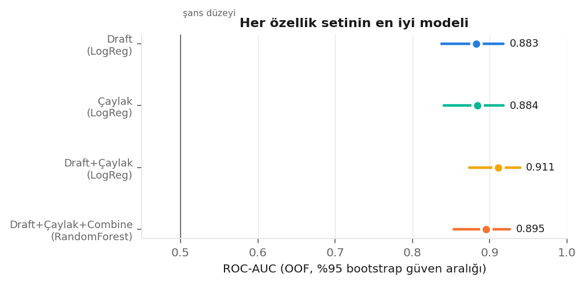
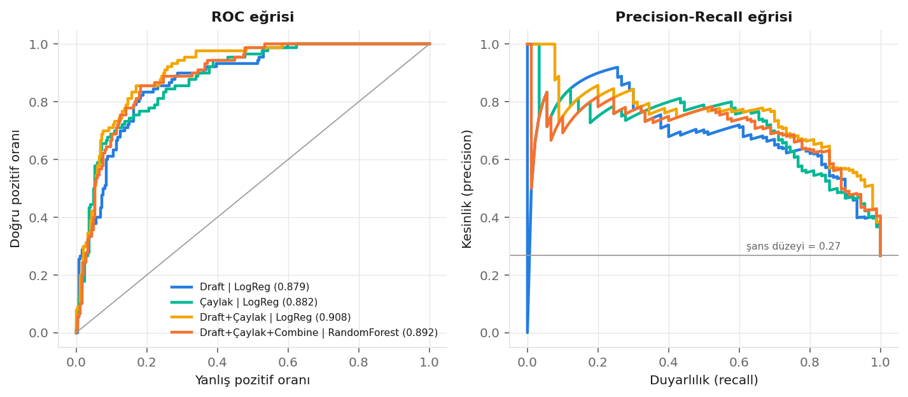

# B1: Çaylak sezonundan sonraki sezonu tahmin

Bu dosya `ders_projesi/gorev_b1.py` tarafından otomatik üretilir. Tasarım: `TASARIM.md`.

## Hedef

- Sonraki normal sezonda `player_play` snap sayısı, kendi draft sınıfı ve pozisyon grubu içinde ilk %25'te (ve > 0).
- 337 oyuncu (2023 sınıfı: çaylak 2023 → 2024; 2024 sınıfı: çaylak 2024 → 2025); 90 pozitif (%26.7).
- Çaylak sezonunda normal sezon kaydı olmayan oyuncu: 84.

## Sonuçlar (5-katlı × 5 tekrar)

| model                               |   auc_ci_low |   auc_ci_high |   auc_mean |   auc_std |   ap_mean |   ap_std |   brier_mean |   brier_std |   logloss_mean |   logloss_std |
|:------------------------------------|-------------:|--------------:|-----------:|----------:|----------:|---------:|-------------:|------------:|---------------:|--------------:|
| Draft+Çaylak | LogReg               |        0.873 |         0.939 |      0.911 |     0.029 |     0.776 |    0.082 |        0.11  |       0.02  |          0.343 |         0.063 |
| Draft+Çaylak+Combine | RandomForest |        0.853 |         0.926 |      0.895 |     0.03  |     0.748 |    0.085 |        0.118 |       0.014 |          0.365 |         0.036 |
| Draft+Çaylak | RandomForest         |        0.849 |         0.923 |      0.892 |     0.027 |     0.733 |    0.081 |        0.119 |       0.015 |          0.366 |         0.044 |
| Draft+Çaylak | kNN                  |        0.849 |         0.923 |      0.891 |     0.036 |     0.721 |    0.094 |        0.122 |       0.017 |          0.372 |         0.041 |
| Çaylak | LogReg                     |        0.841 |         0.918 |      0.884 |     0.033 |     0.737 |    0.078 |        0.12  |       0.019 |          0.378 |         0.057 |
| Draft+Çaylak+Combine | kNN          |        0.851 |         0.921 |      0.884 |     0.036 |     0.717 |    0.091 |        0.134 |       0.011 |          0.406 |         0.05  |
| Draft | LogReg                      |        0.838 |         0.918 |      0.883 |     0.036 |     0.736 |    0.082 |        0.122 |       0.017 |          0.377 |         0.052 |
| Draft+Çaylak | GradBoost            |        0.843 |         0.921 |      0.883 |     0.029 |     0.733 |    0.084 |        0.126 |       0.019 |          0.407 |         0.073 |
| Draft+Çaylak+Combine | SVM          |        0.839 |         0.919 |      0.881 |     0.043 |     0.722 |    0.095 |        0.124 |       0.02  |          0.393 |         0.06  |
| Draft+Çaylak+Combine | LogReg       |        0.841 |         0.916 |      0.879 |     0.031 |     0.705 |    0.081 |        0.134 |       0.022 |          0.427 |         0.082 |
| Draft | GradBoost                   |        0.834 |         0.912 |      0.876 |     0.034 |     0.72  |    0.074 |        0.129 |       0.022 |          0.399 |         0.069 |
| Draft+Çaylak | SVM                  |        0.81  |         0.912 |      0.872 |     0.051 |     0.729 |    0.105 |        0.118 |       0.022 |          0.39  |         0.064 |
| Draft+Çaylak+Combine | GradBoost    |        0.83  |         0.91  |      0.868 |     0.026 |     0.697 |    0.067 |        0.14  |       0.02  |          0.448 |         0.075 |
| Çaylak | kNN                        |        0.818 |         0.903 |      0.865 |     0.036 |     0.706 |    0.082 |        0.131 |       0.016 |          0.397 |         0.042 |
| Çaylak | RandomForest               |        0.812 |         0.901 |      0.861 |     0.033 |     0.687 |    0.087 |        0.13  |       0.016 |          0.408 |         0.046 |
| Draft+Çaylak | MLP                  |        0.852 |         0.925 |      0.85  |     0.066 |     0.677 |    0.103 |        0.157 |       0.037 |          0.485 |         0.095 |
| Çaylak | GradBoost                  |        0.803 |         0.894 |      0.845 |     0.031 |     0.667 |    0.087 |        0.138 |       0.017 |          0.453 |         0.06  |
| Çaylak | SVM                        |        0.762 |         0.884 |      0.832 |     0.055 |     0.701 |    0.098 |        0.127 |       0.021 |          0.415 |         0.055 |
| Draft+Çaylak+Combine | MLP          |        0.824 |         0.906 |      0.799 |     0.111 |     0.6   |    0.143 |        0.164 |       0.04  |          0.496 |         0.102 |
| Çaylak | MLP                        |        0.825 |         0.909 |      0.798 |     0.11  |     0.617 |    0.117 |        0.163 |       0.023 |          0.499 |         0.056 |

**Friedman testi:** χ² = 201.5, p = 1.71e-32

## Hipotez H-B1

Referans: **Draft | LogReg**. Çaylak sezonu bilgisinin AUC'yi anlamlı biçimde artıracağı öngörülmüştü (Holm p < 0.05). Sonuç: **DESTEKLENMEDİ**.

| model                               |   auc_diff_folds |   t_corrected |   p_corrected_t |   auc_diff_oof |   ci_low |   ci_high |   p_bootstrap |   p_holm |
|:------------------------------------|-----------------:|--------------:|----------------:|---------------:|---------:|----------:|--------------:|---------:|
| Draft+Çaylak | LogReg               |           0.028  |        1.8568 |          0.0757 |         0.0296 |   0.007  |    0.0559 |         0.008 |        1 |
| Draft+Çaylak+Combine | RandomForest |           0.0126 |        0.8233 |          0.4184 |         0.0133 |  -0.014  |    0.042  |         0.36  |        1 |
| Draft+Çaylak | RandomForest         |           0.0093 |        0.6428 |          0.5265 |         0.009  |  -0.0165 |    0.0381 |         0.525 |        1 |
| Draft+Çaylak | kNN                  |           0.0083 |        0.4696 |          0.6429 |         0.0085 |  -0.0217 |    0.0416 |         0.605 |        1 |
| Çaylak | LogReg                     |           0.0014 |        0.0599 |          0.9527 |         0.0031 |  -0.0361 |    0.0466 |         0.899 |        1 |
| Draft+Çaylak+Combine | kNN          |           0.0012 |        0.0605 |          0.9522 |         0.0094 |  -0.0223 |    0.0435 |         0.582 |        1 |
| Draft+Çaylak | GradBoost            |          -0      |       -0.0029 |          0.9977 |         0.0054 |  -0.0207 |    0.0312 |         0.689 |        1 |
| Draft+Çaylak+Combine | SVM          |          -0.0015 |       -0.078  |          0.9385 |         0.0016 |  -0.0294 |    0.0346 |         0.971 |        1 |
| Draft+Çaylak+Combine | LogReg       |          -0.0043 |       -0.2063 |          0.8383 |         0.0021 |  -0.0265 |    0.0312 |         0.916 |        1 |
| Draft | GradBoost                   |          -0.0066 |       -0.6717 |          0.5082 |        -0.0049 |  -0.0208 |    0.0119 |         0.581 |        1 |
| Draft+Çaylak | SVM                  |          -0.0105 |       -0.4709 |          0.642  |        -0.0146 |  -0.055  |    0.0241 |         0.451 |        1 |
| Draft+Çaylak+Combine | GradBoost    |          -0.0146 |       -0.9247 |          0.3643 |        -0.0068 |  -0.0338 |    0.0207 |         0.603 |        1 |
| Çaylak | kNN                        |          -0.0182 |       -0.8891 |          0.3828 |        -0.0165 |  -0.0561 |    0.0266 |         0.425 |        1 |
| Çaylak | RandomForest               |          -0.0217 |       -1.1066 |          0.2794 |        -0.0195 |  -0.0638 |    0.0255 |         0.376 |        1 |
| Draft+Çaylak | MLP                  |          -0.0329 |       -0.8717 |          0.392  |         0.0113 |  -0.016  |    0.0413 |         0.458 |        1 |
| Çaylak | GradBoost                  |          -0.0377 |       -1.8162 |          0.0818 |        -0.0276 |  -0.0744 |    0.0176 |         0.227 |        1 |
| Çaylak | SVM                        |          -0.0505 |       -1.9743 |          0.06   |        -0.0513 |  -0.1096 |    0.0038 |         0.067 |        1 |
| Draft+Çaylak+Combine | MLP          |          -0.0837 |       -1.2833 |          0.2116 |        -0.0127 |  -0.0504 |    0.0226 |         0.515 |        1 |
| Çaylak | MLP                        |          -0.0843 |       -1.2636 |          0.2185 |        -0.0098 |  -0.0533 |    0.0386 |         0.668 |        1 |

## Zaman testi: 2023 sınıfıyla eğit, 2024 sınıfında test et

| model                               |   auc |    ap |   brier |   logloss |
|:------------------------------------|------:|------:|--------:|----------:|
| Draft | LogReg                      | 0.899 | 0.702 |   0.117 |     0.364 |
| Çaylak | LogReg                     | 0.878 | 0.73  |   0.119 |     0.374 |
| Draft+Çaylak | LogReg               | 0.909 | 0.747 |   0.109 |     0.336 |
| Draft+Çaylak+Combine | RandomForest | 0.901 | 0.733 |   0.114 |     0.362 |

## Gelecek tahmini: 2025 sınıfı, 2026 sezonu

Seçilen model: **Draft+Çaylak | LogReg**. Sonuç 2026 sezonu bitince belli olacak. Tam liste: `tahmin_2026.csv`. En yüksek 15:

|   nfl_id | display_name      | nfl_position   | position_group   |   draft_overall_pick |   rk_snaps |   rk_games |   Draft+Çaylak | LogReg |   Draft | LogReg |
|---------:|:------------------|:---------------|:-----------------|---------------------:|-----------:|-----------:|------------------------:|-----------------:|
|    58454 | Connor Colby      | G              | OL               |                  249 |        451 |         10 |                   0.983 |            0.04  |
|    58308 | Chimere Dike      | WR             | WR               |                  103 |        385 |         17 |                   0.963 |            0.269 |
|    58247 | Mason Taylor      | TE             | TE               |                   42 |        343 |         13 |                   0.937 |            0.814 |
|    58272 | Harold Fannin     | TE             | TE               |                   67 |        417 |         16 |                   0.925 |            0.661 |
|    58229 | Malaki Starks     | FS             | DB               |                   27 |       1065 |         17 |                   0.919 |            0.829 |
|    58325 | Gunnar Helm       | TE             | TE               |                  120 |        231 |         16 |                   0.911 |            0.441 |
|    58209 | Armand Membou     | T              | OL               |                    7 |       1044 |         17 |                   0.892 |            0.91  |
|    58211 | Kelvin Banks      | T              | OL               |                    9 |       1066 |         17 |                   0.891 |            0.891 |
|    58206 | Will Campbell     | T              | OL               |                    4 |        782 |         13 |                   0.887 |            0.94  |
|    58256 | Nic Scourton      | OLB            | LB               |                   51 |        717 |         17 |                   0.843 |            0.62  |
|    58214 | Tyler Booker      | G              | OL               |                   12 |       1002 |         14 |                   0.838 |            0.867 |
|    58231 | Josh Conerly      | T              | OL               |                   29 |       1054 |         17 |                   0.83  |            0.762 |
|    58249 | Donovan Ezeiruaku | DE             | DL               |                   44 |        603 |         17 |                   0.828 |            0.645 |
|    58220 | Grey Zabel        | G              | OL               |                   18 |       1050 |         17 |                   0.824 |            0.825 |
|    58226 | Donovan Jackson   | G              | OL               |                   24 |        795 |         14 |                   0.757 |            0.789 |

## Sınırlar

- `player_play` hücum snaplerinin kariyer toplamının yaklaşık %79'unu kapsar; hedef buna göre okunmalıdır.
- Hedef göreli bir tanımdır (sınıf ve pozisyon içinde ilk %25); "starter" ile aynı değildir.
- Eğitim verisi iki draft sınıfıdır.