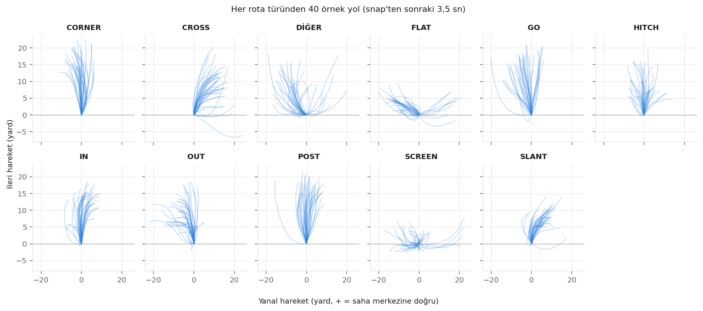
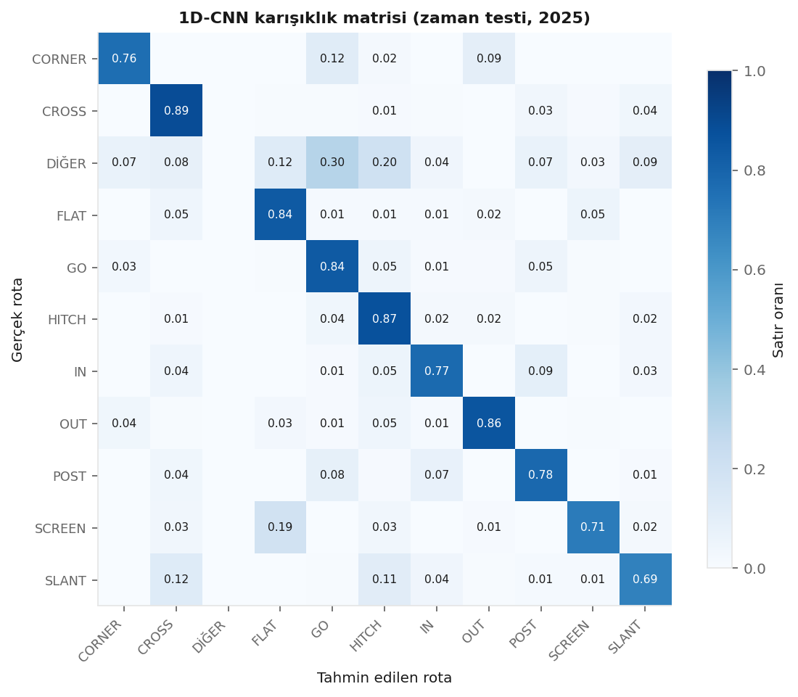

# C1: Maç hareket kaydından rota tanıma

Bu dosya `ders_projesi/gorev_c1.py` tarafından otomatik üretilir. Tasarım: `TASARIM.md`.

- 52930 oyuncu-oyun, 156 oyuncu, 11 sınıf (CORNER, CROSS, DİĞER, FLAT, GO, HITCH, IN, OUT, POST, SCREEN, SLANT). 300'den az örnekli rotalar DİĞER: WHEEL, ANGLE.
- Girdi: snap anından itibaren 35 kare (3,5 sn); en az 15 karesi olan kayıtlar.
- İç/dış yönü saha merkezine göre yaklaşık belirlenir (hareket kaydında top konumu yok).

## 1. Oyuncuya göre gruplu 5-katlı doğrulama

| model        |   macro_f1_mean |   macro_f1_std |   accuracy_mean |   accuracy_std |
|:-------------|----------------:|---------------:|----------------:|---------------:|
| 1D-CNN       |           0.735 |          0.006 |           0.822 |          0.004 |
| MLP          |           0.697 |          0.008 |           0.781 |          0.008 |
| GradBoost    |           0.68  |          0.018 |           0.757 |          0.014 |
| RandomForest |           0.672 |          0.009 |           0.751 |          0.01  |
| LogReg       |           0.636 |          0.007 |           0.728 |          0.01  |
| kNN          |           0.632 |          0.007 |           0.713 |          0.007 |
| En sık sınıf |           0.028 |          0.004 |           0.183 |          0.028 |

### 1D-CNN ile diğer modellerin farkı (düzeltilmiş t-testi + Holm)

| model        |   f1_diff_cnn_minus_model |   t_corrected |   p_corrected_t |   p_holm |
|:-------------|--------------------------:|--------------:|----------------:|---------:|
| En sık sınıf |                    0.707  |      130.546  |          0      |   0      |
| LogReg       |                    0.0992 |       17.2521 |          0.0001 |   0.0003 |
| kNN          |                    0.1036 |       22.0553 |          0      |   0.0001 |
| RandomForest |                    0.0632 |       10.4297 |          0.0005 |   0.0014 |
| GradBoost    |                    0.0548 |        5.4809 |          0.0054 |   0.0075 |
| MLP          |                    0.0386 |        6.0681 |          0.0037 |   0.0075 |

## 2. Zaman testi: 2023–2024 ile eğit, 2025'te test et

| model   |   macro_f1 |   accuracy |
|:--------|-----------:|-----------:|
| 1D-CNN  |      0.728 |      0.818 |
| MLP     |      0.697 |      0.776 |

**McNemar testi** (1D-CNN ve MLP): yalnız CNN doğru = 2079, yalnız MLP doğru = 1079, χ² = 316.0, p = 1.06e-70

| rota   |   örnek_2025 |   F1_CNN |   F1_MLP |
|:-------|-------------:|---------:|---------:|
| CORNER |         2073 |    0.812 |    0.756 |
| CROSS  |         3109 |    0.861 |    0.849 |
| DİĞER  |           74 |    0     |    0.05  |
| FLAT   |         1460 |    0.841 |    0.828 |
| GO     |         4219 |    0.837 |    0.782 |
| HITCH  |         3859 |    0.843 |    0.804 |
| IN     |         2659 |    0.801 |    0.753 |
| OUT    |         2285 |    0.851 |    0.819 |
| POST   |         2286 |    0.768 |    0.686 |
| SCREEN |          521 |    0.68  |    0.651 |
| SLANT  |         1513 |    0.717 |    0.693 |

## Hipotez H-C1

1D-CNN'in en iyi özellik tabanlı modelden (MLP) daha yüksek makro-F1 vereceği ve farkın zaman testinde anlamlı olacağı (McNemar p < 0.05) öngörülmüştü. Sonuç: **DESTEKLENDİ**.

## Sınırlar

- Model yalnız tek oyuncunun hareketini görür; savunmacı ve top konumu yoktur.
- Rota etiketlerinin nasıl üretildiği veri setinde açıklanmamıştır.