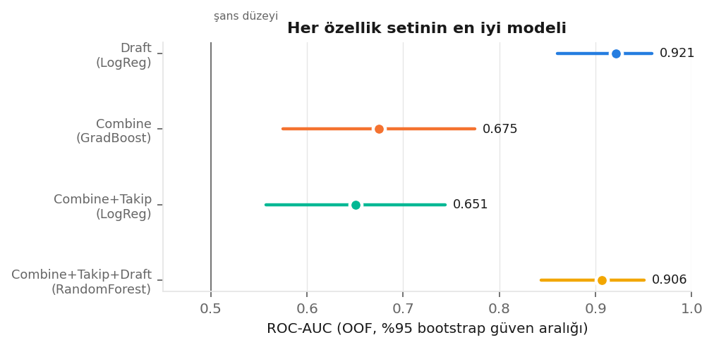
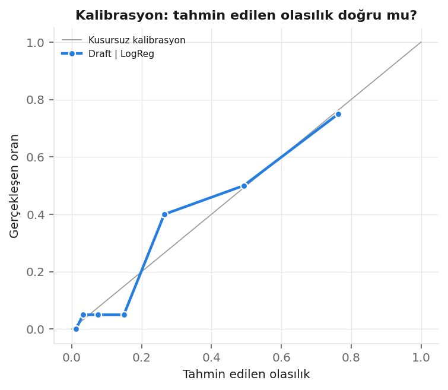

# Gelecek tahmini: ilk 3 sezonda kalıcı starter olacak mı?

Bu dosya `ders_projesi/ileri_tahmin.py` tarafından otomatik üretilir.

## Tasarım (sonuçlar görülmeden belirlendi)

- **Hedef:** ilk 3 sezonda (51 maç) en az %50 maçta ilk 11'de başlamak.
- **Eğitim/doğrulama:** yalnızca 3 sezonu tamamen gözlenen 2023 sınıfı: 160 oyuncu, 36 pozitif (%22.5).
- **Doğrulama:** tabakalı 5-katlı çapraz doğrulama × 10 tekrar (50 test).
- **Model seçimi:** en yüksek ortalama AUC; referans en iyi draft-only model.
- **Girdiler:** yalnızca draft öncesi bilgiler (draft, combine, combine takip özeti). Oyuncunun NFL'de oynadığı sezonlar girdi değildir.
- CNN bu analize alınmadı: 160 oyunculuk eğitim verisi derin öğrenme için çok küçük.

## 1. Doğrulama sonuçları (2023 sınıfı içinde)

| model                              |   auc_ci_low |   auc_ci_high |   auc_mean |   auc_std |   ap_mean |   ap_std |   brier_mean |   brier_std |   logloss_mean |   logloss_std |
|:-----------------------------------|-------------:|--------------:|-----------:|----------:|----------:|---------:|-------------:|------------:|---------------:|--------------:|
| Draft | LogReg                     |        0.86  |         0.958 |      0.921 |     0.048 |     0.804 |    0.103 |        0.093 |       0.024 |          0.299 |         0.07  |
| Draft | GradBoost                  |        0.841 |         0.955 |      0.912 |     0.059 |     0.729 |    0.133 |        0.087 |       0.03  |          0.303 |         0.108 |
| Combine+Takip+Draft | RandomForest |        0.843 |         0.95  |      0.906 |     0.05  |     0.775 |    0.106 |        0.105 |       0.018 |          0.341 |         0.045 |
| Combine+Takip+Draft | LogReg       |        0.828 |         0.935 |      0.88  |     0.055 |     0.721 |    0.111 |        0.118 |       0.032 |          0.363 |         0.09  |
| Combine+Takip+Draft | GradBoost    |        0.812 |         0.935 |      0.875 |     0.057 |     0.718 |    0.123 |        0.126 |       0.037 |          0.411 |         0.128 |
| Combine+Takip+Draft | SVM          |        0.778 |         0.905 |      0.851 |     0.063 |     0.696 |    0.105 |        0.126 |       0.023 |          0.391 |         0.062 |
| Combine | GradBoost                |        0.575 |         0.775 |      0.675 |     0.096 |     0.471 |    0.135 |        0.175 |       0.031 |          0.57  |         0.109 |
| Combine | LogReg                   |        0.556 |         0.753 |      0.654 |     0.082 |     0.423 |    0.103 |        0.176 |       0.023 |          0.539 |         0.067 |
| Combine | RandomForest             |        0.552 |         0.751 |      0.651 |     0.077 |     0.452 |    0.107 |        0.165 |       0.014 |          0.508 |         0.039 |
| Combine+Takip | LogReg             |        0.557 |         0.743 |      0.651 |     0.085 |     0.409 |    0.116 |        0.187 |       0.028 |          0.573 |         0.087 |
| Combine+Takip | RandomForest       |        0.542 |         0.741 |      0.65  |     0.073 |     0.423 |    0.11  |        0.166 |       0.012 |          0.509 |         0.031 |
| Combine+Takip | SVM                |        0.542 |         0.735 |      0.636 |     0.116 |     0.42  |    0.131 |        0.17  |       0.011 |          0.519 |         0.028 |
| Combine+Takip | GradBoost          |        0.529 |         0.733 |      0.624 |     0.093 |     0.413 |    0.121 |        0.193 |       0.032 |          0.635 |         0.12  |
| Combine | SVM                      |        0.519 |         0.722 |      0.624 |     0.119 |     0.412 |    0.122 |        0.171 |       0.011 |          0.523 |         0.028 |

**Seçilen model:** Draft | LogReg  ·  **Referans:** Draft | LogReg

### Referansla karşılaştırma (düzeltilmiş t-testi + Holm, eşli bootstrap)

| model                              |   auc_diff_folds |   t_corrected |   p_corrected_t |   auc_diff_oof |   ci_low |   ci_high |   p_bootstrap |   p_holm |
|:-----------------------------------|-----------------:|--------------:|----------------:|---------------:|---------:|----------:|--------------:|---------:|
| Draft | GradBoost                  |          -0.0087 |       -0.4595 |          0.6479 |        -0.0121 |  -0.0403 |    0.0141 |         0.404 |   0.8916 |
| Combine+Takip+Draft | RandomForest |          -0.0147 |       -0.7686 |          0.4458 |        -0.0148 |  -0.0565 |    0.0219 |         0.472 |   0.8916 |
| Combine+Takip+Draft | LogReg       |          -0.041  |       -1.7667 |          0.0835 |        -0.028  |  -0.0634 |    0.0025 |         0.073 |   0.2505 |
| Combine+Takip+Draft | GradBoost    |          -0.0457 |       -2.3817 |          0.0212 |        -0.0376 |  -0.0763 |   -0.0046 |         0.025 |   0.1058 |
| Combine+Takip+Draft | SVM          |          -0.0702 |       -2.1813 |          0.034  |        -0.069  |  -0.1279 |   -0.0157 |         0.015 |   0.136  |
| Combine | GradBoost                |          -0.2463 |       -4.8541 |          0      |        -0.2366 |  -0.3436 |   -0.1298 |         0     |   0.0001 |
| Combine | LogReg                   |          -0.2669 |       -5.2203 |          0      |        -0.2614 |  -0.3706 |   -0.1502 |         0     |   0      |
| Combine | RandomForest             |          -0.2698 |       -6.3936 |          0      |        -0.2625 |  -0.3725 |   -0.1573 |         0     |   0      |
| Combine+Takip | LogReg             |          -0.2701 |       -5.4137 |          0      |        -0.2634 |  -0.3698 |   -0.1551 |         0     |   0      |
| Combine+Takip | RandomForest       |          -0.2707 |       -6.5017 |          0      |        -0.2679 |  -0.3782 |   -0.1591 |         0     |   0      |
| Combine+Takip | SVM                |          -0.2847 |       -4.5385 |          0      |        -0.2769 |  -0.3815 |   -0.173  |         0     |   0.0003 |
| Combine+Takip | GradBoost          |          -0.2971 |       -5.7532 |          0      |        -0.282  |  -0.3944 |   -0.1714 |         0     |   0      |
| Combine | SVM                      |          -0.2972 |       -4.481  |          0      |        -0.2948 |  -0.4072 |   -0.1802 |         0     |   0.0003 |

## 2. Ek zaman kontrolü: 2023 ile eğit, 2024'te test et

2024 sınıfının 3. sezonu henüz oynanmadığı için hedef olarak 2 sezonluk oran (34 maçta ≥ %50) kullanıldı. Bu, asıl hedefin **yaklaşık** bir karşılığıdır.

| model                              |   auc |    ap |   brier |   logloss |
|:-----------------------------------|------:|------:|--------:|----------:|
| Draft | LogReg                     | 0.925 | 0.771 |   0.092 |     0.291 |
| Combine | GradBoost                | 0.712 | 0.426 |   0.175 |     0.547 |
| Combine+Takip | LogReg             | 0.736 | 0.507 |   0.152 |     0.492 |
| Combine+Takip+Draft | RandomForest | 0.929 | 0.773 |   0.098 |     0.324 |

## 3. Gelecek tahminleri (2024 ve 2025 sınıfları)

350 oyuncu. Sonuç 2024 sınıfı için 2026, 2025 sınıfı için 2027 sezonu sonunda belli olacak; bu tahminlerin doğruluğu bugün ölçülemez. Tam liste: `gelecek_tahminleri.csv`.

**Seçilen modele göre en yüksek olasılıklı 15 oyuncu:**

| display_name     |   draft_year | nfl_position   |   draft_overall_pick |   simdiye_kadar_oran |   Draft | LogReg |
|:-----------------|-------------:|:---------------|---------------------:|---------------------:|-----------------:|
| Will Campbell    |         2025 | T              |                    4 |                0.765 |            0.959 |
| Joe Alt          |         2024 | T              |                    5 |                0.647 |            0.949 |
| J.C. Latham      |         2024 | T              |                    7 |                0.882 |            0.932 |
| Armand Membou    |         2025 | T              |                    7 |                1     |            0.932 |
| Rome Odunze      |         2024 | WR             |                    9 |                0.706 |            0.915 |
| Kelvin Banks     |         2025 | T              |                    9 |                1     |            0.915 |
| Tyler Booker     |         2025 | G              |                   12 |                0.824 |            0.891 |
| Taliese Fuaga    |         2024 | T              |                   14 |                0.882 |            0.876 |
| Laiatu Latu      |         2024 | DE             |                   15 |                0.5   |            0.868 |
| Byron Murphy     |         2024 | DT             |                   16 |                0.765 |            0.861 |
| Grey Zabel       |         2025 | G              |                   18 |                1     |            0.847 |
| Jared Verse      |         2024 | OLB            |                   19 |                0.971 |            0.841 |
| Troy Fautanu     |         2024 | T              |                   20 |                0.529 |            0.834 |
| Chop Robinson    |         2024 | OLB            |                   21 |                0.118 |            0.827 |
| Quinyon Mitchell |         2024 | CB             |                   22 |                0.941 |            0.821 |

### Kısmi tutarlılık (doğrulama değildir)

Tahminin, bu oyuncuların şimdiye kadar oynadığı sezonlardaki starter durumuyla ne kadar uyuştuğu (AUC). 2025 sınıfında yalnız 1 sezon gözlendi.

| model                              |   draft_year |   auc_simdiye_kadar |
|:-----------------------------------|-------------:|--------------------:|
| Draft | LogReg                     |         2024 |               0.925 |
| Draft | LogReg                     |         2025 |               0.894 |
| Combine | GradBoost                |         2024 |               0.712 |
| Combine | GradBoost                |         2025 |               0.761 |
| Combine+Takip | LogReg             |         2024 |               0.736 |
| Combine+Takip | LogReg             |         2025 |               0.687 |
| Combine+Takip+Draft | RandomForest |         2024 |               0.929 |
| Combine+Takip+Draft | RandomForest |         2025 |               0.846 |

## Sınırlar

- Eğitim verisi küçüktür (160 oyuncu, 36 pozitif); güven aralıkları geniştir.
- Model tek bir draft sınıfından öğrenir; sınıflar arası farklar (ör. kadro ihtiyacı) modelde yoktur.
- Gelecek tahminleri ancak 2026 ve 2027 sezonları bitince doğrulanabilir.