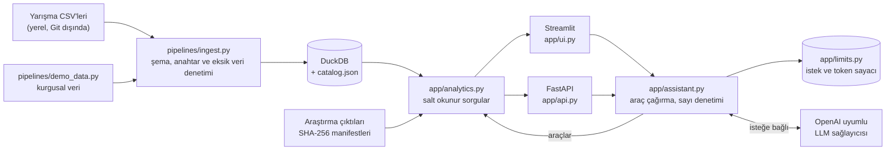

# Mimari ve veri akışı

## Bir sohbet sorusunun yolu

1. İstek sınırları denetlenir; aşılmışsa sağlayıcıya gidilmez.
2. Model en az bir yerel veri aracı çağırır. Araçlar yalnızca DuckDB'den okur.
3. Her sağlayıcı çağrısından önce token bütçesi ayrılır, sonra gerçek kullanımla düzeltilir.
4. Yanıttaki sayılar araç sonuçlarıyla eşleşmezse sayılı yanıt gösterilmez.
5. Yanıta oyuncu, sezon, maç türü ve kaynak tablo satırı eklenir.

## Kararlar

| Konu | Davranış |
| --- | --- |
| Hatalı veri yüklemesi | Önceki geçerli veritabanı korunur |
| Eksik değer | `null` kalır, sıfır sayılmaz |
| Demo | Veritabanının kataloğundan anlaşılır; araştırma çıktıları gösterilmez |
| LLM anahtarı yok | Sohbet kapalı, diğer ekranlar çalışır |
| Sayaç okunamıyor | Sohbet kapanır |

Araştırma kodları (`scripts/`, notebook'lar) uygulamadan ayrıdır. Uygulama model eğitmez,
kayıtlı araştırma sonuçlarını gösterir. Barındırma ayrıntıları: [Docker, demo ve yayın](DEMO_VE_YAYIN.md).
