# Görev A: Draft öncesi veriden kalıcı starter tahmini

Bu dosya `nfl/gorev_a.py` tarafından otomatik üretilir; tablolardaki her sayı aynı çalıştırmanın çıktısıdır.

## 1. Hedef tanımları

- `start_rate = career_games_started / (17 × oynanabilir sezon)`; kariyer verisi 2025 sezonu sonuna kadardır (2023 sınıfı 3, 2024 sınıfı 2, 2025 sınıfı 1 sezon).
- **Ana hedef:** `start_rate ≥ 0.5` (kalıcı starter). Bu tanım "yıldız" değil, "takımında kalıcı yer edinen oyuncu" anlamına gelir.
- **Dayanıklılık hedefleri:** eşik 0.4 ve 0.6; pozisyona göre ayarlı tanım = aynı pozisyon grubu ve draft sınıfı içinde sezon başına snap (hücum + savunma) sıralamasında ilk %20. OTHER grubu (1 RB, 1 FB) kendi içinde sıralanamadığı için bu tanımda pozitif sayılmaz.

|                      |   pozitif |    % |
|:---------------------|----------:|-----:|
| Starter ≥ 0.5 (ana)  |       103 | 20.2 |
| Starter ≥ 0.4        |       123 | 24.1 |
| Starter ≥ 0.6        |        83 | 16.3 |
| Pozisyonunda ilk %20 |       111 | 21.8 |

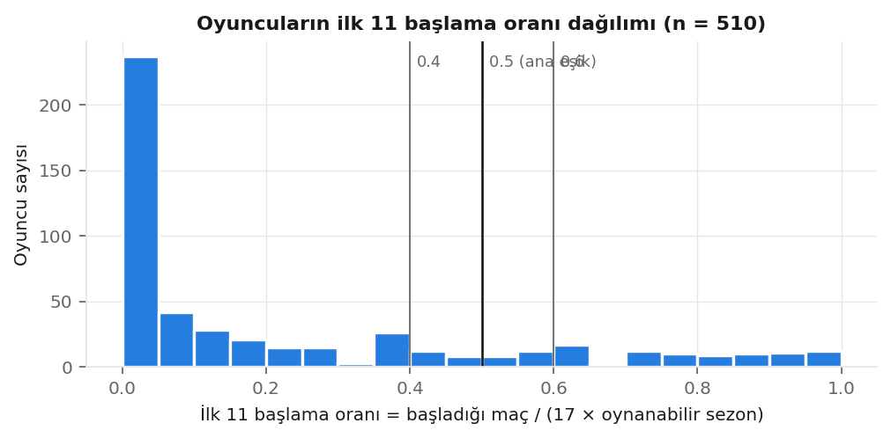

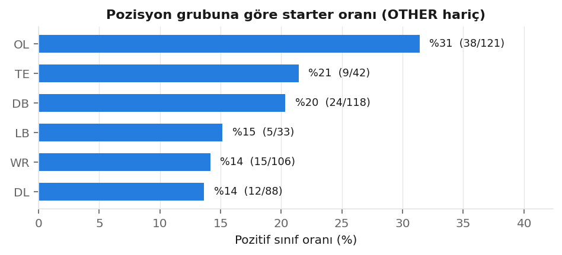

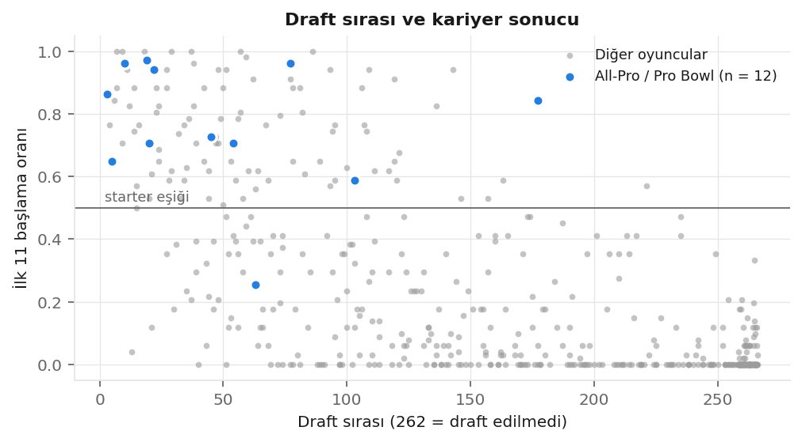

## 2. Protokol

- Tekrarlı tabakalı 5-katlı çapraz doğrulama × 5 tekrar (tabaka = etiket × draft yılı); tüm modeller aynı bölmeleri kullanır.
- Ön işleme (medyan doldurma + eksik göstergesi + standartlaştırma) yalnız eğitim katmanında öğrenilir.
- Model ayarları sabittir (ayar araması yapılmadı); bu, modeller arası adil karşılaştırma içindir, her modelin en iyi hâlini temsil etmez.
- CNN: her dril denemesi (hız, ivme, dönüş hızı, kümülatif mesafe; 10 Hz) 1D-CNN ile kodlanır, oyuncunun tüm denemeleri ortalanır. Hibrit model bu gömmeyi tablo özellikleriyle birleştirir. CNN modelleri yalnız ana hedefte çalıştırıldı.

## 3. Ana sonuçlar

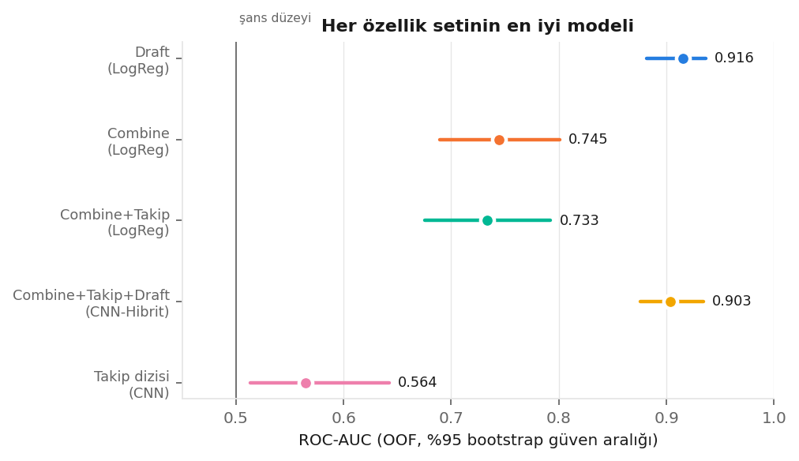

| model                              | AUC %95 GA (OOF)   |   auc_mean |   auc_std |   ap_mean |   ap_std |   brier_mean |   brier_std |   logloss_mean |   logloss_std |
|:-----------------------------------|:-------------------|-----------:|----------:|----------:|---------:|-------------:|------------:|---------------:|--------------:|
| Draft | LogReg                     | [0.881, 0.937]     |      0.916 |     0.031 |     0.756 |    0.077 |        0.092 |       0.015 |          0.288 |         0.042 |
| Combine+Takip+Draft | CNN-Hibrit   | [0.875, 0.935]     |      0.903 |     0.032 |     0.736 |    0.079 |        0.097 |       0.015 |          0.31  |         0.045 |
| Draft | GradBoost                  | [0.858, 0.926]     |      0.903 |     0.04  |     0.715 |    0.094 |        0.099 |       0.019 |          0.316 |         0.066 |
| Combine+Takip+Draft | LogReg       | [0.862, 0.926]     |      0.896 |     0.036 |     0.723 |    0.08  |        0.099 |       0.018 |          0.32  |         0.058 |
| Combine+Takip+Draft | RandomForest | [0.858, 0.925]     |      0.895 |     0.044 |     0.743 |    0.087 |        0.099 |       0.012 |          0.322 |         0.038 |
| Combine+Takip+Draft | GradBoost    | [0.859, 0.924]     |      0.891 |     0.043 |     0.72  |    0.081 |        0.104 |       0.02  |          0.338 |         0.076 |
| Combine+Takip+Draft | SVM          | [0.838, 0.913]     |      0.878 |     0.039 |     0.717 |    0.074 |        0.103 |       0.015 |          0.331 |         0.043 |
| Combine+Takip+Draft | kNN          | [0.798, 0.881]     |      0.836 |     0.045 |     0.642 |    0.072 |        0.126 |       0.007 |          0.416 |         0.058 |
| Combine | LogReg                   | [0.689, 0.801]     |      0.745 |     0.035 |     0.489 |    0.062 |        0.139 |       0.008 |          0.441 |         0.021 |
| Combine+Takip | LogReg             | [0.675, 0.792]     |      0.733 |     0.038 |     0.473 |    0.066 |        0.142 |       0.009 |          0.458 |         0.026 |
| Combine+Takip+Draft | MLP          | [0.749, 0.846]     |      0.73  |     0.134 |     0.491 |    0.158 |        0.146 |       0.028 |          0.454 |         0.072 |
| Combine | GradBoost                | [0.684, 0.796]     |      0.723 |     0.055 |     0.496 |    0.069 |        0.142 |       0.013 |          0.462 |         0.045 |
| Combine | SVM                      | [0.667, 0.783]     |      0.723 |     0.043 |     0.477 |    0.07  |        0.14  |       0.007 |          0.447 |         0.019 |
| Combine+Takip | SVM                | [0.665, 0.778]     |      0.72  |     0.054 |     0.488 |    0.075 |        0.139 |       0.009 |          0.444 |         0.023 |
| Combine | RandomForest             | [0.661, 0.780]     |      0.718 |     0.051 |     0.496 |    0.076 |        0.139 |       0.008 |          0.447 |         0.025 |
| Combine+Takip | CNN-Hibrit         | [0.670, 0.780]     |      0.716 |     0.05  |     0.468 |    0.085 |        0.143 |       0.009 |          0.452 |         0.025 |
| Combine+Takip | RandomForest       | [0.650, 0.771]     |      0.709 |     0.049 |     0.494 |    0.08  |        0.14  |       0.008 |          0.45  |         0.022 |
| Combine+Takip | GradBoost          | [0.632, 0.755]     |      0.685 |     0.058 |     0.468 |    0.077 |        0.148 |       0.013 |          0.491 |         0.048 |
| Combine+Takip | kNN                | [0.578, 0.704]     |      0.64  |     0.061 |     0.401 |    0.07  |        0.153 |       0.006 |          0.485 |         0.035 |
| Combine | kNN                      | [0.563, 0.694]     |      0.625 |     0.058 |     0.397 |    0.079 |        0.153 |       0.006 |          0.493 |         0.043 |
| Combine+Takip | MLP                | [0.556, 0.690]     |      0.587 |     0.096 |     0.333 |    0.097 |        0.172 |       0.018 |          0.527 |         0.046 |
| Combine | MLP                      | [0.537, 0.671]     |      0.571 |     0.074 |     0.307 |    0.086 |        0.171 |       0.014 |          0.527 |         0.036 |
| Takip dizisi | CNN                 | [0.513, 0.642]     |      0.564 |     0.072 |     0.28  |    0.054 |        0.161 |       0.005 |          0.504 |         0.015 |
| Draft | Dummy                      | [0.426, 0.552]     |      0.5   |     0     |     0.202 |    0.005 |        0.161 |       0.003 |          0.503 |         0.007 |

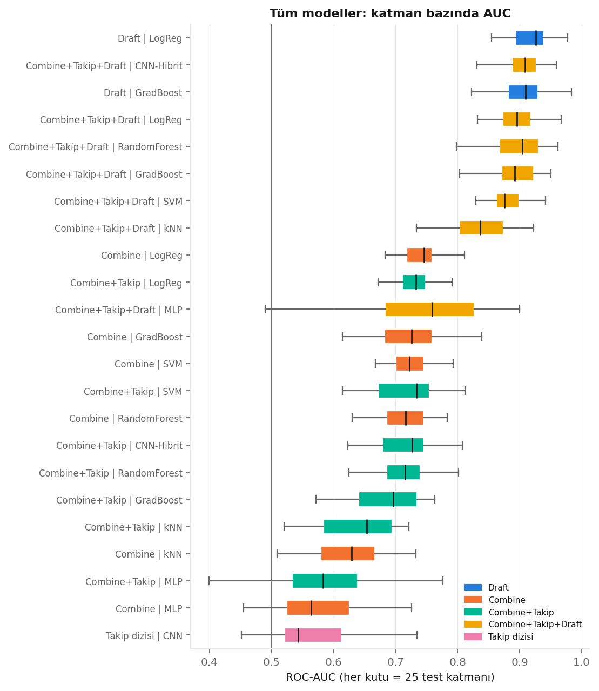

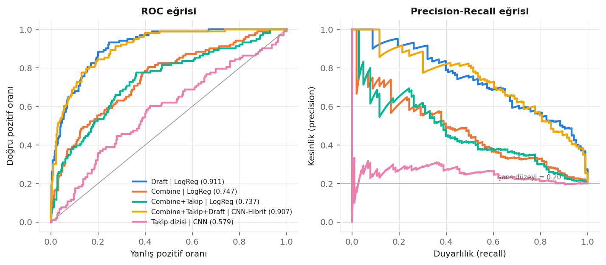

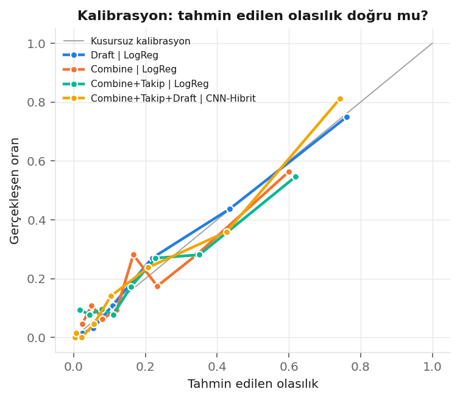

## 4. İstatistiksel testler

**Friedman testi** (Dummy hariç tüm modeller, katman AUC'leri): χ² = 474.0, p = 1.87e-86

Ortalama sıra (1 = en iyi), ilk 10:

| model                              |   ortalama_sıra |
|:-----------------------------------|----------------:|
| Draft | LogReg                     |            2    |
| Combine+Takip+Draft | CNN-Hibrit   |            3.12 |
| Draft | GradBoost                  |            3.48 |
| Combine+Takip+Draft | RandomForest |            4.46 |
| Combine+Takip+Draft | LogReg       |            4.52 |
| Combine+Takip+Draft | GradBoost    |            4.66 |
| Combine+Takip+Draft | SVM          |            5.88 |
| Combine+Takip+Draft | kNN          |            8.28 |
| Combine | LogReg                   |           11.42 |
| Combine+Takip | LogReg             |           12.38 |

**Referans = en iyi Draft modeli (Draft | LogReg)**. Düzeltilmiş t-testi: Nadeau & Bengio (2003), Holm düzeltmeli. Bootstrap: OOF tahminlerinde eşli 2000 tekrar.

| model                              |   auc_diff_folds |   t_corrected |   p_corrected_t |   auc_diff_oof |   ci_low |   ci_high |   p_bootstrap |   p_holm |
|:-----------------------------------|-----------------:|--------------:|----------------:|---------------:|---------:|----------:|--------------:|---------:|
| Combine+Takip+Draft | CNN-Hibrit   |          -0.0124 |       -1.3219 |          0.1987 |        -0.0045 |  -0.0232 |    0.0128 |         0.644 |   0.3891 |
| Draft | GradBoost                  |          -0.0126 |       -1.3345 |          0.1946 |        -0.0167 |  -0.0305 |   -0.0044 |         0.009 |   0.3891 |
| Combine+Takip+Draft | LogReg       |          -0.0199 |       -1.7413 |          0.0944 |        -0.0154 |  -0.0338 |    0.0018 |         0.082 |   0.3237 |
| Combine+Takip+Draft | RandomForest |          -0.0211 |       -2.152  |          0.0417 |        -0.0171 |  -0.0372 |    0.0015 |         0.067 |   0.2083 |
| Combine+Takip+Draft | GradBoost    |          -0.0242 |       -1.8221 |          0.0809 |        -0.0177 |  -0.0368 |   -0.0001 |         0.049 |   0.3237 |
| Combine+Takip+Draft | SVM          |          -0.038  |       -2.4391 |          0.0225 |        -0.0339 |  -0.0649 |   -0.0063 |         0.015 |   0.1492 |
| Combine+Takip+Draft | kNN          |          -0.0799 |       -4.0006 |          0.0005 |        -0.0696 |  -0.1035 |   -0.0397 |         0     |   0.0042 |
| Combine | LogReg                   |          -0.1709 |       -7.478  |          0      |        -0.164  |  -0.2228 |   -0.1093 |         0     |   0      |
| Combine+Takip | LogReg             |          -0.1824 |       -8.6356 |          0      |        -0.1741 |  -0.2356 |   -0.1156 |         0     |   0      |
| Combine+Takip+Draft | MLP          |          -0.186  |       -2.4635 |          0.0213 |        -0.1131 |  -0.156  |   -0.0725 |         0     |   0.1492 |
| Combine | GradBoost                |          -0.1922 |       -6.9936 |          0      |        -0.1717 |  -0.228  |   -0.1137 |         0     |   0      |
| Combine | SVM                      |          -0.1922 |       -7.6949 |          0      |        -0.1839 |  -0.2449 |   -0.1249 |         0     |   0      |
| Combine+Takip | SVM                |          -0.1952 |       -7.8276 |          0      |        -0.189  |  -0.249  |   -0.1318 |         0     |   0      |
| Combine | RandomForest             |          -0.1975 |       -8.2426 |          0      |        -0.1895 |  -0.2476 |   -0.1301 |         0     |   0      |
| Combine+Takip | CNN-Hibrit         |          -0.1995 |       -6.9293 |          0      |        -0.185  |  -0.241  |   -0.1305 |         0     |   0      |
| Combine+Takip | RandomForest       |          -0.2062 |      -10.0227 |          0      |        -0.199  |  -0.2607 |   -0.1425 |         0     |   0      |
| Combine+Takip | GradBoost          |          -0.2306 |       -8.2531 |          0      |        -0.217  |  -0.28   |   -0.1566 |         0     |   0      |
| Combine+Takip | kNN                |          -0.2757 |       -8.2849 |          0      |        -0.2689 |  -0.3333 |   -0.2059 |         0     |   0      |
| Combine | kNN                      |          -0.2907 |       -8.1903 |          0      |        -0.2817 |  -0.3507 |   -0.2142 |         0     |   0      |
| Combine+Takip | MLP                |          -0.329  |       -6.199  |          0      |        -0.2877 |  -0.3568 |   -0.2182 |         0     |   0      |
| Combine | MLP                      |          -0.3451 |       -8.5632 |          0      |        -0.3083 |  -0.3758 |   -0.2433 |         0     |   0      |
| Takip dizisi | CNN                 |          -0.3512 |       -8.9089 |          0      |        -0.3322 |  -0.3992 |   -0.2667 |         0     |   0      |
| Draft | Dummy                      |          -0.4156 |      -24.5404 |          0      |        -0.423  |  -0.4902 |   -0.3515 |         0     |   0      |

## 5. Draft sınıfı dışarıda bırakma

İki draft sınıfıyla eğit, üçüncüsünde test et (ana hedef).

| model                            |   2023 |   2024 |   2025 |
|:---------------------------------|-------:|-------:|-------:|
| Combine | LogReg                 |  0.712 |  0.767 |  0.715 |
| Combine+Takip | LogReg           |  0.714 |  0.698 |  0.713 |
| Combine+Takip+Draft | CNN-Hibrit |  0.884 |  0.92  |  0.852 |
| Draft | LogReg                   |  0.921 |  0.925 |  0.894 |
| Takip dizisi | CNN               |  0.519 |  0.559 |  0.611 |

## 6. Dayanıklılık: hedef tanımı değişince

Her hücre o özellik setinin o hedefte en iyi sklearn modelinin 5×5 CV ortalama AUC'sidir.

|                     |   Starter ≥ 0.5 (ana) |   Starter ≥ 0.4 |   Starter ≥ 0.6 |   Pozisyonunda ilk %20 |
|:--------------------|----------------------:|----------------:|----------------:|-----------------------:|
| Draft               |                 0.916 |           0.882 |           0.913 |                  0.881 |
| Combine             |                 0.745 |           0.708 |           0.771 |                  0.7   |
| Combine+Takip       |                 0.733 |           0.698 |           0.751 |                  0.695 |
| Combine+Takip+Draft |                 0.896 |           0.864 |           0.903 |                  0.865 |

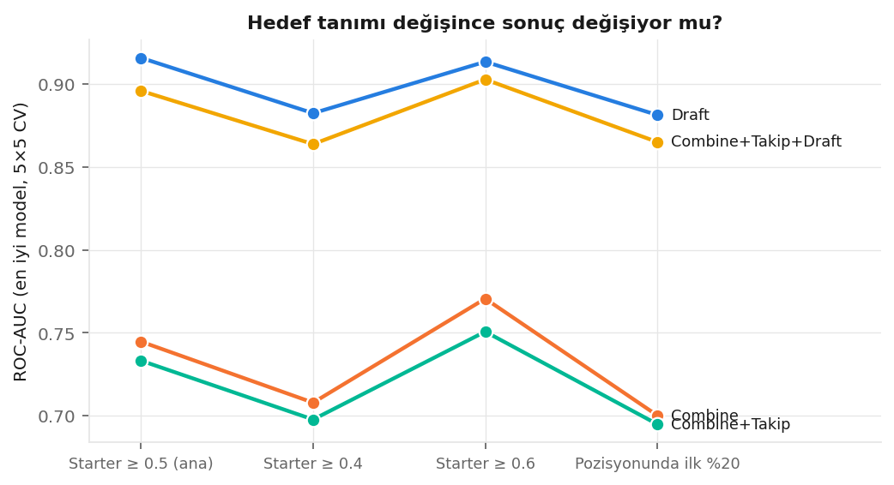

## 7. Pozisyon grubuna göre (ana hedef, OOF tahminleri)

5'ten az pozitif veya negatif örneği olan hücreler boş bırakıldı.

|    |   Draft |   Combine |   Combine+Takip |   Combine+Takip+Draft |   Takip dizisi |
|:---|--------:|----------:|----------------:|----------------------:|---------------:|
| DB |   0.891 |     0.624 |           0.643 |                 0.847 |          0.489 |
| DL |   0.879 |     0.776 |           0.74  |                 0.874 |          0.352 |
| LB |   0.893 |     0.479 |           0.536 |                 0.879 |          0.357 |
| OL |   0.97  |     0.817 |           0.803 |                 0.965 |          0.425 |
| TE |   0.902 |     0.771 |           0.737 |                 0.869 |          0.293 |
| WR |   0.904 |     0.753 |           0.747 |                 0.892 |          0.543 |

|    |   n |   pos |
|:---|----:|------:|
| DB | 118 |    24 |
| DL |  88 |    12 |
| LB |  33 |     5 |
| OL | 121 |    38 |
| TE |  42 |     9 |
| WR | 106 |    15 |

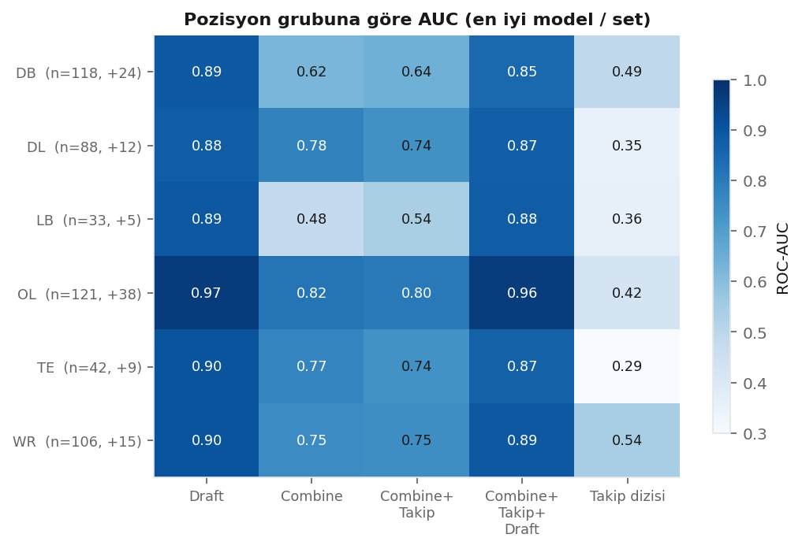

## 8. Ödüllü oyuncu kontrolü (All-Pro / Pro Bowl)

Ödüllü oyuncular model hedefi değildir; modelin onları üst sıralara koyup koymadığına bakılır. Yüzdelik = oyuncunun 510 kişi içindeki tahmin sırası (1.0 = en yüksek).

| set                 | model                            |   honors_n |   honors_mean_percentile |   honors_min_percentile |   auc_honors_vs_rest |
|:--------------------|:---------------------------------|-----------:|-------------------------:|------------------------:|---------------------:|
| Draft               | Draft | LogReg                   |         12 |                    0.859 |                   0.459 |                0.867 |
| Combine             | Combine | LogReg                 |         12 |                    0.684 |                   0.194 |                0.687 |
| Combine+Takip       | Combine+Takip | LogReg           |         12 |                    0.674 |                   0.288 |                0.677 |
| Combine+Takip+Draft | Combine+Takip+Draft | CNN-Hibrit |         12 |                    0.828 |                   0.486 |                0.835 |
| Takip dizisi        | Takip dizisi | CNN               |         12 |                    0.462 |                   0.051 |                0.46  |

## 9. Hangi bilgi önemli? (permütasyon önemi, ilk 12)

**Combine+Takip | LogReg**

|                       |   AUC_kaybı |
|:----------------------|------------:|
| age_at_draft          |      0.1292 |
| ngs_athleticism_score |      0.0301 |
| pos_DB                |      0.0271 |
| speed_score           |      0.0217 |
| cohort_2025           |      0.016  |
| pos_DL                |      0.0159 |
| three_cone            |      0.0158 |
| combine_weight        |      0.0111 |
| trk_cone_peak_a       |      0.0099 |
| trk_cone_peak_s       |      0.009  |
| arm_length            |      0.007  |
| ten_yd_split          |      0.0069 |

**Combine+Takip+Draft | LogReg**

|                    |   AUC_kaybı |
|:-------------------|------------:|
| round_filled       |      0.0913 |
| log_pick           |      0.0784 |
| pos_DB             |      0.0085 |
| pos_DL             |      0.0084 |
| broad_jump         |      0.0071 |
| arm_length         |      0.0067 |
| bmi                |      0.0066 |
| speed_score        |      0.0063 |
| cohort_2025        |      0.0059 |
| forty              |      0.0056 |
| trk_shuttle_peak_s |      0.0055 |
| combine_weight     |      0.0051 |

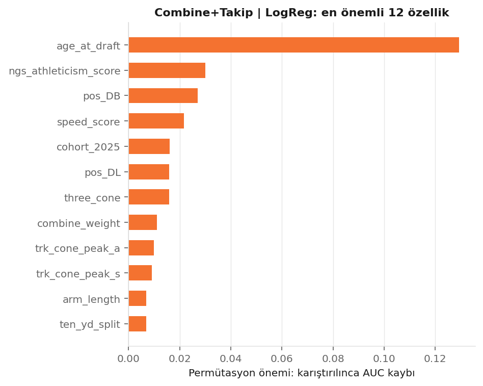

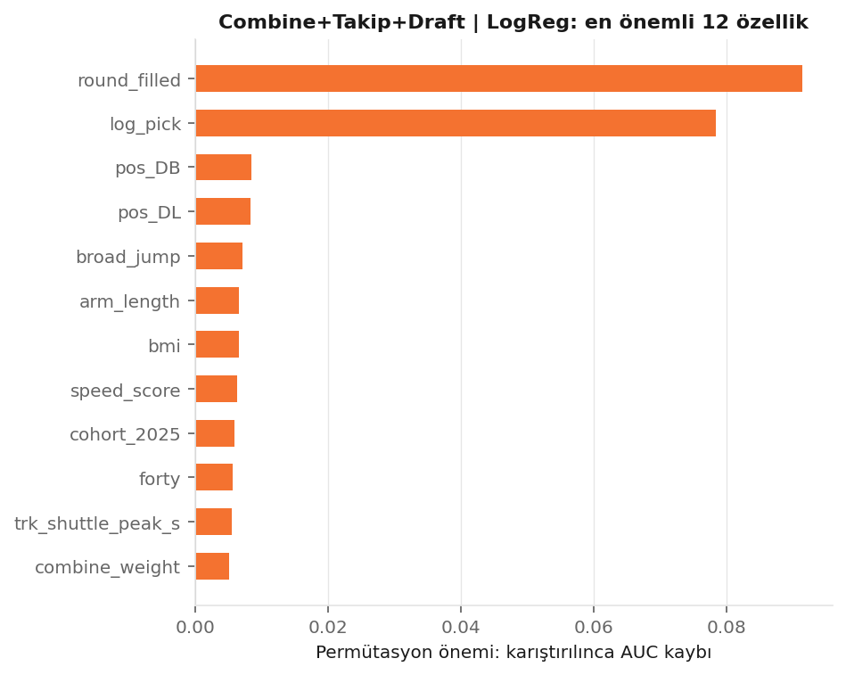

## 10. Sınırlar

- Örnek küçüktür (510 oyuncu, ana hedefte 103 pozitif); güven aralıkları buna göre okunmalıdır.
- 2025 sınıfı için hedef yalnız çaylak sezonunu yansıtır.
- Kariyer toplamları sezonlara bölünmüş değildir; bu görevde yalnız hedef olarak kullanıldı.
- Model ayarları aranmadı; daha iyi ayarlarla mutlak skorlar değişebilir.