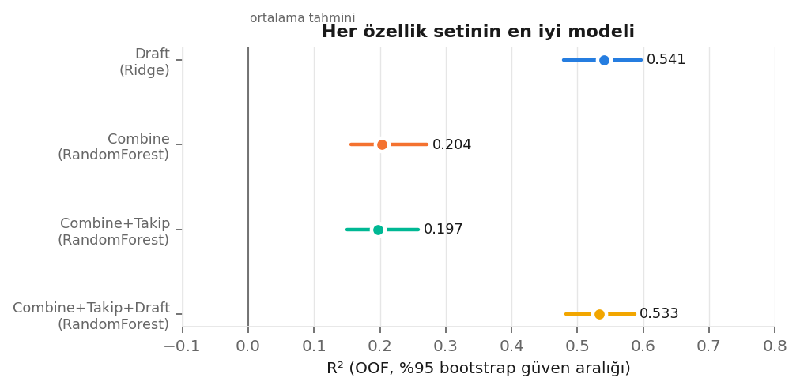
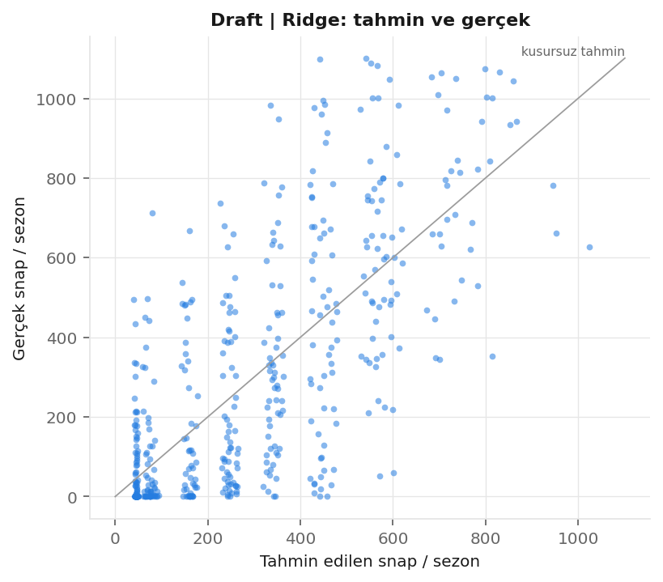

# A2: Sezon başına snap sayısı tahmini (regresyon)

Bu dosya `nfl/gorev_a2.py` tarafından otomatik üretilir. Tasarım: `TASARIM.md`.

- Oyuncu: 510; hedef = (hücum + savunma snap) / oynanabilir sezon; ortalama 280, medyan 152, sıfır olan 105 oyuncu.
- 5-katlı × 5 tekrar (25 test); ana ölçüt R².

## Sonuçlar

| model                              |   r2_ci_low |   r2_ci_high |   r2_mean |   r2_std |   mae_mean |   mae_std |   rmse_mean |   rmse_std |   spearman_mean |   spearman_std |
|:-----------------------------------|------------:|-------------:|----------:|---------:|-----------:|----------:|------------:|-----------:|----------------:|---------------:|
| Draft | Ridge                      |       0.479 |        0.597 |     0.541 |    0.056 |    156.693 |     9.605 |     206.958 |     11.294 |           0.753 |          0.031 |
| Combine+Takip+Draft | RandomForest |       0.482 |        0.587 |     0.533 |    0.054 |    164.679 |     8.904 |     208.862 |     11.773 |           0.743 |          0.041 |
| Combine+Takip+Draft | GradBoost    |       0.487 |        0.615 |     0.532 |    0.083 |    156.038 |     9.968 |     208.249 |     14.134 |           0.71  |          0.05  |
| Combine+Takip+Draft | Ridge        |       0.463 |        0.591 |     0.518 |    0.073 |    162.474 |     9.706 |     211.607 |     12.864 |           0.714 |          0.054 |
| Combine+Takip+Draft | SVR          |       0.46  |        0.573 |     0.507 |    0.059 |    162.472 |     8.987 |     214.321 |     11.189 |           0.722 |          0.047 |
| Draft | GradBoost                  |       0.433 |        0.57  |     0.495 |    0.069 |    162.894 |     9.479 |     216.723 |     12.091 |           0.732 |          0.035 |
| Combine+Takip+Draft | MLP          |       0.434 |        0.564 |     0.386 |    0.112 |    186.833 |    14.068 |     238.615 |     18.583 |           0.655 |          0.062 |
| Combine+Takip+Draft | kNN          |       0.279 |        0.359 |     0.312 |    0.049 |    204.713 |     9.431 |     253.92  |     13.13  |           0.627 |          0.073 |
| Combine | RandomForest             |       0.157 |        0.272 |     0.204 |    0.062 |    222.818 |     9.127 |     273     |     11.788 |           0.44  |          0.076 |
| Combine+Takip | RandomForest       |       0.15  |        0.258 |     0.197 |    0.055 |    225.462 |     8.044 |     274.198 |     11.53  |           0.434 |          0.081 |
| Combine+Takip | GradBoost          |       0.126 |        0.292 |     0.176 |    0.08  |    218.357 |     9.915 |     277.489 |     13.13  |           0.42  |          0.063 |
| Combine | GradBoost                |       0.112 |        0.282 |     0.165 |    0.083 |    219.712 |    10.732 |     279.172 |     11.368 |           0.421 |          0.069 |
| Combine | Ridge                    |       0.099 |        0.245 |     0.157 |    0.105 |    224.538 |    10.618 |     280.208 |     12.406 |           0.416 |          0.102 |
| Combine+Takip | SVR                |       0.099 |        0.241 |     0.156 |    0.071 |    214.454 |     8.4   |     280.896 |     12.126 |           0.452 |          0.082 |
| Combine | SVR                      |       0.089 |        0.241 |     0.145 |    0.082 |    217.667 |    10.832 |     282.723 |     12.258 |           0.417 |          0.08  |
| Combine+Takip | Ridge              |       0.073 |        0.238 |     0.133 |    0.128 |    224.005 |    12.742 |     283.94  |     15.24  |           0.414 |          0.115 |
| Combine | MLP                      |       0.129 |        0.268 |     0.108 |    0.088 |    231.849 |    14.403 |     288.746 |     15.825 |           0.357 |          0.09  |
| Combine | kNN                      |       0.056 |        0.138 |     0.087 |    0.055 |    242.641 |     7.461 |     292.472 |     11.464 |           0.256 |          0.123 |
| Combine+Takip | kNN                |       0.04  |        0.108 |     0.066 |    0.048 |    243.87  |     8.355 |     295.872 |     13.859 |           0.232 |          0.119 |
| Combine+Takip | MLP                |       0.088 |        0.244 |     0.022 |    0.195 |    237.015 |    19.227 |     300.948 |     25.154 |           0.359 |          0.126 |
| Draft | Ortalama                   |      -0.011 |       -0     |    -0.003 |    0.003 |    259.637 |     9.102 |     306.796 |     14.751 |         nan     |        nan     |

**Friedman testi:** χ² = 406.7, p = 1.75e-74

## Hipotez H-A2

Referans: **Draft | Ridge**. Combine/Takip bilgisinin Draft modelinin R²'sini anlamlı biçimde artırmayacağı öngörülmüştü. Sonuç: **DESTEKLENDİ**.

| model                              |   r2_diff_folds |   t_corrected |   p_corrected_t |   r2_diff_oof |   ci_low |   ci_high |   p_bootstrap |   p_holm |
|:-----------------------------------|----------------:|--------------:|----------------:|--------------:|---------:|----------:|--------------:|---------:|
| Combine+Takip+Draft | RandomForest |         -0.008  |       -0.5206 |          0.6074 |       -0.0053 |  -0.0324 |    0.0247 |         0.69  |   1      |
| Combine+Takip+Draft | GradBoost    |         -0.009  |       -0.3527 |          0.7274 |        0.0113 |  -0.0241 |    0.0456 |         0.511 |   1      |
| Combine+Takip+Draft | Ridge        |         -0.0225 |       -1.0949 |          0.2844 |       -0.0119 |  -0.0405 |    0.0154 |         0.402 |   0.8533 |
| Combine+Takip+Draft | SVR          |         -0.0334 |       -1.9761 |          0.0598 |       -0.0241 |  -0.0623 |    0.0167 |         0.234 |   0.239  |
| Draft | GradBoost                  |         -0.0452 |       -2.8768 |          0.0083 |       -0.037  |  -0.0603 |   -0.0156 |         0     |   0.0415 |
| Combine+Takip+Draft | MLP          |         -0.1548 |       -3.0379 |          0.0057 |       -0.0402 |  -0.0807 |   -0.0004 |         0.045 |   0.034  |
| Combine+Takip+Draft | kNN          |         -0.2289 |       -7.1989 |          0      |       -0.2247 |  -0.2697 |   -0.1738 |         0     |   0      |
| Combine | RandomForest             |         -0.3371 |      -10.4937 |          0      |       -0.3303 |  -0.3954 |   -0.2616 |         0     |   0      |
| Combine+Takip | RandomForest       |         -0.3436 |      -11.2022 |          0      |       -0.3383 |  -0.403  |   -0.2707 |         0     |   0      |
| Combine+Takip | GradBoost          |         -0.3646 |       -9.4942 |          0      |       -0.3304 |  -0.4177 |   -0.2478 |         0     |   0      |
| Combine | GradBoost                |         -0.3752 |       -9.7052 |          0      |       -0.3442 |  -0.4301 |   -0.2577 |         0     |   0      |
| Combine | Ridge                    |         -0.3834 |       -7.7039 |          0      |       -0.3701 |  -0.4435 |   -0.2958 |         0     |   0      |
| Combine+Takip | SVR                |         -0.3843 |      -10.0483 |          0      |       -0.3692 |  -0.4499 |   -0.2893 |         0     |   0      |
| Combine | SVR                      |         -0.396  |       -8.7156 |          0      |       -0.3772 |  -0.454  |   -0.2981 |         0     |   0      |
| Combine+Takip | Ridge              |         -0.4078 |       -6.8575 |          0      |       -0.386  |  -0.4678 |   -0.3013 |         0     |   0      |
| Combine | MLP                      |         -0.4324 |       -9.9553 |          0      |       -0.3435 |  -0.4101 |   -0.2768 |         0     |   0      |
| Combine | kNN                      |         -0.454  |      -12.7034 |          0      |       -0.4469 |  -0.5039 |   -0.3858 |         0     |   0      |
| Combine+Takip | kNN                |         -0.4744 |      -13.3512 |          0      |       -0.4683 |  -0.5264 |   -0.4037 |         0     |   0      |
| Combine+Takip | MLP                |         -0.5182 |       -5.3925 |          0      |       -0.374  |  -0.4543 |   -0.2978 |         0     |   0.0001 |
| Draft | Ortalama                   |         -0.5432 |      -17.9216 |          0      |       -0.5457 |  -0.5999 |   -0.4827 |         0     |   0      |

## Sınırlar

- Hedef kariyer toplamlarından hesaplanır; sezonlara bölünmüş değildir.
- Snap sayısının dağılımı çarpıktır (çok sayıda sıfır); R² bu yapıdan etkilenir.