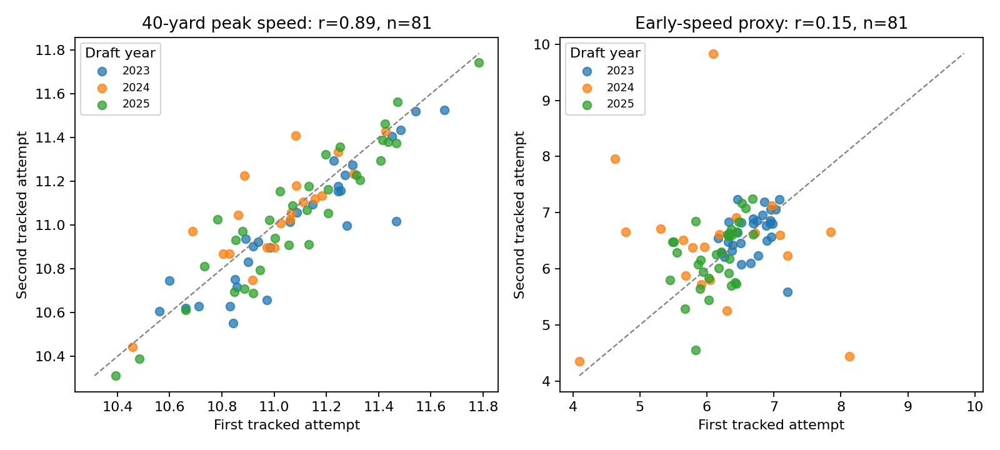
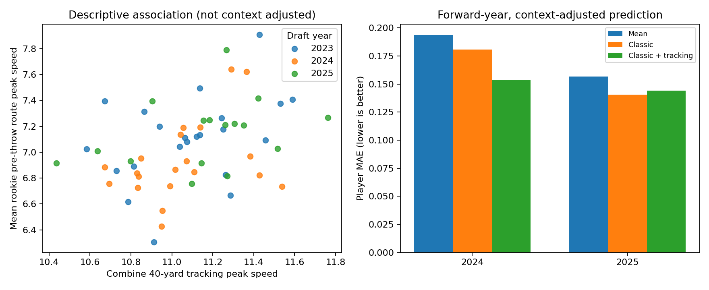

# Repeatable Speed, Uncertain Added Value
## What Combine tracking tells us about rookie receiver route speed

### The football question

A fast 40-yard dash is a familiar scouting input. A tracking chip offers richer
measurements, but richer data do not automatically improve player evaluation.
We ask: **Do tracking-derived running features add information beyond official
40-yard time, height and weight when predicting a receiver's rookie-season route speed?**

Our central result is a distinction: Combine peak speed is repeatable and associated
with game movement, but its incremental predictive value is not established across
draft classes. This matters when deciding whether a new sensor metric deserves
additional weight in a scouting process.

### 1. Measure comparable opportunities

We link the competition's 2023–2025 Combine tracking to the same players' rookie
regular-season game tracking. Restricting to wide receivers avoids explaining
differences between positions instead of differences between players. Restricting
to rookie seasons avoids giving older classes more career exposure.

The game metric is **pre-throw route peak speed**: the 95th percentile of a
three-frame median-smoothed speed stream, from snap to pass release, capped at four
seconds. Eligible plays need a route label, one snap and one throw event, at least
two seconds and twenty frames, no duplicate timestamps or gaps exceeding 0.21 seconds,
and no nullifying penalty. This measures movement on observed routes, not maximum
athletic capacity or overall receiving success.

The extraction scans 22,654,290 game-tracking rows. It produces 12,688 eligible
player-plays for 79 receivers. Requiring tracked 40-yard data and at least 30
eligible rookie plays leaves **58 receivers and 10,944 player-plays**: 22, 20 and
16 receivers from the 2023, 2024 and 2025 classes.

Combine features are (1) the same smoothed 95th-percentile speed (`yd/s`) over the 40-yard
attempt, and (2) an early-speed proxy (`yd/s`), measured one second after the first observed
speed of at least `1.0 yd/s`. Attempt features are median-aggregated
per player. The second feature is not an official acceleration split: the true start
time is not provided, and seven of 174 receiver attempts already start above our threshold.

Next Gen Stats tracking coordinates are in `yards` and speeds in `yd/s` (`10 Hz` sampling).
Coordinate-derived speed and supplied speed are numerically consistent:
median ratios are approximately `0.99` in both Combine and game tracking.

### 2. Ask whether the measurement repeats

Among 81 receivers with two tracked 40-yard attempts, the peak-speed feature has
**repeat-attempt Pearson r = 0.893** (player-bootstrap 95% interval 0.828–0.939).
The early-speed proxy is substantially less repeatable: **r = 0.153**
(−0.195–0.536). Peak-speed repeat correlations remain positive and high within
each class: 0.910, 0.806 and 0.937.

This is evidence about these feature definitions, not proof that early acceleration
is intrinsically unmeasurable. Approximate start alignment and measurement noise
can undermine a plausible-looking feature.

### 3. Association is present; added value is uncertain

Across the 58 eligible receivers, Combine peak speed and mean game route peak speed
have **r = 0.382** (exploratory player-bootstrap interval 0.194–0.550). Removing
each draft class's means leaves r = 0.365, so the pooled association is not solely
a difference between class means. Within-class estimates are positive but imprecise.

The raw game measure has an alternating-game split-half correlation of 0.620,
using disjoint sets of games and at least ten eligible plays in each half. This is
a descriptive stability check, not an independent prediction test.

For prediction, a training-only model adjusts game speed for route, coverage,
window duration and its square, snap speed and cushion. The target is each player's
mean residual. We train on 2023 and test 2024, then train on 2023–2024 and test 2025.
No player appears in both training and test. Imputation and scaling are training-only.

All models use ridge regression with fixed penalty 10. There is no hyperparameter
search. We compare the training-mean reference, official 40 time + height + weight,
and those three features plus the two tracking measures. Evaluation weights players
equally. The windows, sample threshold, features and models were written down before
computing speed-outcome results.

| Test class | Train / test receivers | Mean-reference MAE | Classic MAE | Classic + tracking MAE |
|---|---:|---:|---:|---:|
| 2024 | 22 / 20 | 0.1938 | 0.1808 | 0.1535 |
| 2025 | 42 / 16 | 0.1569 | 0.1405 | 0.1442 |

Lower MAE is better. Errors are in `yd/s`.

Tracking reduces MAE by approximately 15.1% in 2024, but increases it by 2.6% in
2025. Paired player-bootstrap intervals for the absolute improvement are
**[−0.0008, 0.0539]** and **[−0.0211, 0.0142]**, respectively. Both include zero.
These intervals condition on fitted models and do not capture training uncertainty.
RMSE decreases in both years, from 0.2124 to 0.1927 and from 0.1717 to 0.1700;
the latter difference is very small. Our prespecified primary metric is MAE.

### 4. Explain the limits instead of selecting the best year

Peak speed overlaps strongly with official 40 time (r = −0.852). A repeatable
measurement can therefore convey familiar information rather than an independent
scouting advantage. A post-hoc check removing the low-repeatability early proxy
does not resolve the cross-year inconsistency: peak-only added-feature MAE is
0.1770 in 2024 and 0.1415 in 2025. We label this check post-hoc and retain the
original primary results.

Earlier exploratory analyses of curl-turn features and receiver separation also
failed to show consistent added value, including route-matched and man-coverage
subsets. Those trials remain in the project experiment register. The speed analysis
is exploratory too: these draft classes were examined previously, and the diagnostics
are not multiplicity-adjusted. We do not present a selected association as a new
confirmatory discovery.

### What teams can use

The actionable output is a reproducible three-step evaluation: **check repeated
attempts, link the measure to a specific game behavior, then test added value in
a later class**. A metric should pass all three before receiving additional
scouting weight. Here, peak speed passes a repeatability check and has a game-speed
association; consistent incremental prediction remains unproven.

These findings do not support a new prospect ranking. They do support treating
the early-speed proxy cautiously and avoiding double-counting information already
captured by 40-yard time. The notebook exposes the filters and per-player predictions
so analysts can audit where the conclusion comes from.

Important limitations include small test classes, selection of Combine participants
with enough rookie playing time, and exclusion of quick throws and plays without
a throw. Tactical route depth, team usage and opponent effects remain only partly
addressed. Game speed is not separation, production, or causal player ability.
Future confirmation needs additional classes and a more carefully aligned start
measurement, rather than further tuning on these same players.

### Reproducibility and context

The attached notebook rebuilds the analysis from the competition CSVs on CPU,
without external datasets. A fresh local notebook execution is compared with the
script outputs. The project includes the analysis design and complete trial register.

Sources: [competition](https://www.kaggle.com/competitions/nfl-big-data-bowl-2027),
[NFL announcement](https://www.nfl.com/news/big-data-bowl-returns-powered-by-aws),
and [host timing discussion](https://www.kaggle.com/competitions/nfl-big-data-bowl-2027/discussion/751371).
A [survey of public work](https://hackers.pocketplay.win/en/kaggle/nfl-big-data-bowl-2027/)
consulted after our primary speed analysis describes earlier timing/repeatability
investigations. We do not claim those methodological ideas as novel; all numerical
results reported here were computed from the supplied competition files.
